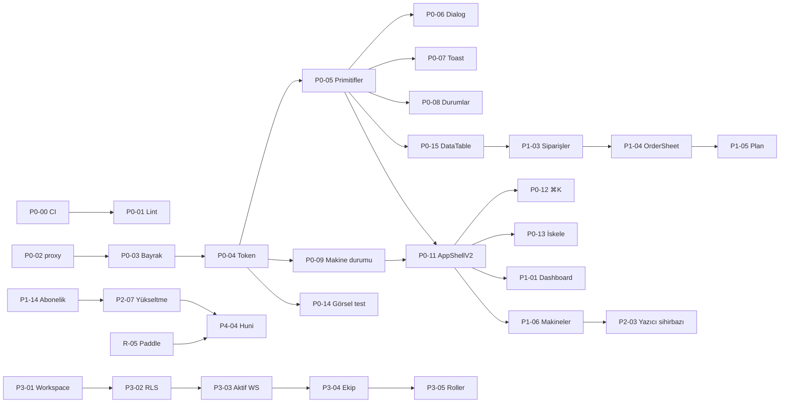

# 06 — Uygulama Backlog'u

> Her bilet tek başına bir PR'dır ve `ui_v2` bayrağı arkasında (veya bayraktan bağımsız, davranış değiştirmeyen altyapı olarak) **tek başına yayınlanabilir**.
> Uygulayıcı her bilete başlamadan önce `07-implementer-prompt.md` şablonunu kullanır ve 02/03/04/05 dokümanlarının ilgili bölümlerini okur.

## Ortak tanımlar (her bilette geçerli)

**SV — Standart doğrulama** (her biletin sonunda sırayla çalıştırılır, hepsi geçmeli):

```bash
npx tsc --noEmit
npx eslint <değişen dosyalar/klasörler>          # 0 hata; P0-01 sonrası 0 uyarı
npm run test:unit                                 # P0-00 sonrası mevcut
npm run build
rg -n "zinc-|sky-|indigo-|emerald-|amber-|violet-|#[0-9a-fA-F]{6}|text-\[1[01]px\]|glass|btn-gradient" src/components/ds src/components/v2 src/features   # 0 sonuç
```

**SV-E2E** (UI içeren biletlerde; dev sunucu `PORT=3100 npm run dev` arka planda):

```bash
PLAYWRIGHT_BASE_URL=http://localhost:3100 npx playwright test e2e/smoke.spec.ts
PLAYWRIGHT_BASE_URL=http://localhost:3100 npx playwright test e2e/visual   # P0-14 sonrası; yeni ekran için baseline ekle
```

**SV-UI** (UI içeren biletlerde, tarayıcıda elle — cursor-ide-browser MCP ile):
1. `http://localhost:3100/<rota>?ui=v2` aç; 1440 px ve 390 px genişlikte ekran görüntüsü al.
2. Yalnızca klavye ile (Tab/Shift+Tab/Enter/Esc/oklar) tüm etkileşimleri tamamla; odak halkası her yerde görünür.
3. `?ui=v1` ile legacy ekranın **değişmediğini** doğrula.
4. Konsolda hata/uyarı yok (React key, hydration).

**Boyut:** S ≤ ½ gün · M ≈ 1 gün · L 2–3 gün (Composer 2.5 fast için; L biletleri alt adımlara bölünmüş yazılmıştır).

**21st çağrısı (kalıp):**
```text
GetDynamicTools {"namespace":"user-21st","toolName":"get_component"}
CallDynamicTool {"namespace":"user-21st","toolName":"get_component","arguments":{"id":<ID>},"mcpDetails":{"description":"Fetch 21st.dev component <ID> source for PrintFlow"}}
```
Ardından `04-21st-components.md §2` uyarlama kuralları.

**Genel YAPMA listesi** (`07-implementer-prompt.md` §4'te tam hali): SSE canlı sayfaları/hook'larını bozma · Türkçe metni silme veya İngilizceye çevirme · token yerine sabit renk yazma · Next.js dokümanlarını okumadan Next API'si kullanma · `apps/printflow-bridge` (Go) ve `tools/printflow-bridge` koduna dokunma · commit/push yapma (kullanıcı istemedikçe) · legacy ekranın davranışını değiştirme · migration'ı prod'a uygulama.

## Faz özeti

| Faz | Amaç | Bilet | Süre (tahmini) |
|---|---|---|---|
| R | Gelir hazırlığı (repo, Vercel, migration, Paddle, Resend, köprü CDN, yasal) | 8 (R-01…R-08, 05 §4) | paralel, 1–4. hafta |
| 0 | Temel: hijyen, bayrak, token, primitifler, kabuk, ⌘K, tablo, test altyapısı | 16 | 1. hafta |
| 1 | Tüm mevcut ekranların v2'si | 16 | 2–3. hafta |
| 2 | Aktivasyon & gelir akışları (onboarding, yazıcı sihirbazı, yükseltme) | 10 | 3–4. hafta |
| 3 | Kurumsal (çalışma alanı, roller, denetim, bildirim, dışa aktarım…) | 17 | 5–8. hafta |
| 4 | Pazarlama, fiyatlandırma, huni, marka, yasal | 6 | 4–6. hafta |
| 5 | Sertleştirme ve lansman (a11y, perf, analitik, açık tema, legacy temizlik) | 9 | 6–8. hafta |
| **Toplam** | | **74 + 8 (R)** | ~8 hafta |

Kritik yol: P0-00 → P0-03 → P0-04 → P0-05 → P0-11 → P1-01/P1-06 → P2-03 → P2-07 → (R-05) → satış.

---

# FAZ 0 — Temel

### P0-00 · Depo hijyeni ve web CI
- **Amaç:** CI'ın kurulabilmesi ve örnek env'in depoya girmesi.
- **Önkoşul:** R-01 (proje kendi deposunda). R-01 yapılmadıysa yalnızca dosyaları hazırla, CI'ı çalıştırma.
- **Dosyalar:**
  - `.gitignore` — `.env*` satırının altına `!.env.local.example` ekle.
  - `.github/workflows/web-ci.yml` — 05 §5'teki içerik (lint adımı bu bilette `npx eslint src` *hatalara izin vererek değil*: P0-01 bitene kadar `continue-on-error: true` ile).
  - `package.json` — script ekle: `"typecheck": "tsc --noEmit"`, `"test:unit": "npx tsx --test \"src/**/*.test.ts\""`.
  - `.env.local.example` — tüm env adlarını (05 §7 listesi + `UI_V2_DEFAULT`, `NEXT_PUBLIC_UI_V2_BETA`, `E2E_EMAIL`, `E2E_PASSWORD`) değersiz ve Türkçe yorumlu listele.
- **21st:** yok.
- **Kabul:** `npm run test:unit` yerelde yeşil (ağ gerektiren test varsa glob yerine açık liste kullan ve bileti açıklamada not et); workflow YAML geçerli (`npx --yes action-validator .github/workflows/web-ci.yml` veya GitHub'da çalışma); `git check-ignore .env.local.example` çıktı vermez.
- **Doğrulama:** SV (build dahil).
- **Boyut:** S · **Bağımlılık:** R-01 (yumuşak)
- **Yapma:** gerçek secret değeri yazma; `printflow-bridge-release.yml`'e dokunma.

### P0-01 · Lint temeli (0 hata, 0 uyarı)
- **Amaç:** CI kalite kapısını yeşile çekmek.
- **Dosyalar ve düzeltmeler** (01-audit §4.8):
  - `src/components/ui/input.tsx`, `src/components/ui/select.tsx` — boş interface → `type InputProps = React.InputHTMLAttributes<HTMLInputElement>` vb.
  - `react-hooks/set-state-in-effect`: `src/app/(dashboard)/catalog/[id]/page.tsx` (3), `catalog/page.tsx`, `src/components/machines/machine-camera-panel.tsx`, `src/components/machines/workshop-bridge-modal.tsx`, `src/components/planning/job-modal.tsx`, `src/components/viewer/stl-viewer.tsx`, `src/hooks/use-speech-recognition.ts` — desenler: (a) prop'tan türetilen state → render sırasında hesapla veya `key` ile sıfırla; (b) form başlangıç değeri → `useState(() => init)` + açılışta `key={job?.id ?? "new"}`; (c) dış sistem senkronu → olay işleyicisine taşı. React Compiler açık (`reactCompiler: true`), bu yüzden gereksiz `useMemo/useCallback` eklemeyin.
  - `react-hooks/purity`: `src/components/dashboard/machine-fleet-panel.tsx` — render'da `Date.now()` → `useNow(intervalMs)` hook'u (`src/hooks/use-now.ts`, `useSyncExternalStore` ile).
  - Uyarılar: kullanılmayan importları sil; `exhaustive-deps` → bağımlılığı ekle veya mantığı effect dışına al; `` → `next/image` (`unoptimized` gerekirse Supabase storage URL'leri için `next.config.ts` `images.remotePatterns` ekle — `node_modules/next/dist/docs/01-app/03-api-reference/02-components/image.md` oku).
  - `web-ci.yml` — lint adımından `continue-on-error` kaldır, `--max-warnings=0`.
- **Kabul:** `npx eslint src --max-warnings=0` çıkış kodu 0. Davranış değişmez (katalog detay, iş modalı düzenleme, kamera paneli, STL görüntüleyici, sesli not elle denenir).
- **Doğrulama:** SV + SV-E2E (smoke) + elle: `/catalog/<id>` aç/düzenle, planlamada iş düzenle, sesli not.
- **Boyut:** M · **Bağımlılık:** –
- **Yapma:** `eslint-disable` yorumu ekleme (gerekçesiz); lint kuralını kapatma.

### P0-02 · `middleware.ts` → `proxy.ts`
- **Amaç:** Next 16 deprecation'ı gidermek; bayrak cookie'si için kanca.
- **Önce oku:** `node_modules/next/dist/docs/01-app/01-getting-started/16-proxy.md`, `…/03-api-reference/03-file-conventions/proxy.md` (yoksa `middleware.md`), `…/02-guides/upgrading/version-16.md` (proxy bölümü).
- **Dosyalar:** `src/middleware.ts` → `src/proxy.ts` (codemod: `npx @next/codemod@canary middleware-to-proxy .`; çıktıyı gözden geçir). Export adı dokümana göre (`proxy`). `config.matcher` aynen korunur. `src/lib/supabase/middleware.ts` dosya adı aynen kalabilir (yalnızca import).
- **Kabul:** oturumsuz `/dashboard` → `/login` yönlendirme; oturumlu `/login` → `/dashboard`; `/api/*` atlanır; `next build` çıktısında "Proxy" görünür, deprecation uyarısı yok.
- **Doğrulama:** SV + SV-E2E smoke.
- **Boyut:** S · **Bağımlılık:** –
- **Yapma:** Auth mantığını değiştirme; edge/node runtime ayarını dokümana aykırı değiştirme.

### P0-03 · `ui_v2` özellik bayrağı
- **Amaç:** v1/v2 ekranlarını güvenle yan yana çalıştırmak (05 §3).
- **Dosyalar:**
  - `src/lib/flags/ui-version.ts` — 05 §3.1 taslağı + `UI_COOKIE`, `parseUiParam(v: string|null): UiVersion|null`.
  - `src/lib/flags/ui-version.test.ts` — `parseUiParam` ve env varsayılanı testleri (cookie okuma kısmı saf fonksiyona ayrılır: `resolveUiVersion({ cookie, env })`).
  - `src/proxy.ts` — `?ui=v1|v2` görürse `pf_ui` cookie yaz (`maxAge: 31536000`, `sameSite: "lax"`, `secure: process.env.NODE_ENV === "production"`, `path: "/"`) ve parametreyi kaldırarak 307 yönlendir. Supabase oturum güncellemesiyle birlikte çalışmalı (aynı response nesnesinde cookie'ler korunmalı).
  - `src/app/layout.tsx` — `const ui = await getUiVersion();` → `<html lang="tr" data-ui={ui} data-theme="dark" data-density="comfortable">`. Body sınıfları: v1'de mevcut `bg-zinc-950 text-zinc-100`, v2'de `bg-background text-foreground`.
  - `src/app/(dashboard)/layout.tsx` — henüz AppShellV2 yok; yalnızca `ui` değerini hesapla ve legacy shell'i render et (P0-11 bağlar).
  - `src/components/flags/ui-version-provider.tsx` — client context (`useUiVersion()`), root layout'tan değer alır.
  - `package.json` — `"test:flags": "npx tsx --test src/lib/flags/*.test.ts"`.
- **Kabul:** `/?ui=v2` → cookie set, URL temiz, `<html data-ui="v2">`; `/?ui=v1` geri alır; cookie yokken `UI_V2_DEFAULT=true` ile v2. Görsel olarak hiçbir şey değişmez (henüz v2 ekran yok).
- **Doğrulama:** SV + `npm run test:flags` + tarayıcıda DevTools → Application → Cookies.
- **Boyut:** S · **Bağımlılık:** P0-02
- **Yapma:** Bayrağı client-only (localStorage) yapma — SSR titremesi olur.

### P0-04 · Tasarım token'ları, fontlar, `tw-animate-css`
- **Amaç:** Forge tasarım sisteminin CSS temeli (02 §2–§11).
- **Önce oku:** `node_modules/next/dist/docs/01-app/01-getting-started/11-css.md`, `13-fonts.md`.
- **Dosyalar:**
  - `npm i tw-animate-css` (sürüm: `npm view tw-animate-css version`).
  - `src/styles/tokens.css` — 02 §3.1, §3.2, §3.3, §6 (density), §11 (focus/z) bloklarını **aynen**.
  - `src/styles/motion.css` — 02 §9 bloğu.
  - `src/app/globals.css` — 02 §4: başa importlar, `@custom-variant dark`, yeni `@theme inline`; mevcut tüm eski kurallar dosyanın sonunda `/* ===== LEGACY (v1) ===== */` başlığı altına **içerik değişmeden** taşınır. Eski `:root { --background… }` bloğu silinir (tokens.css tanımlıyor; değerler yalnızca body için kullanılıyordu). `html { scroll-padding-top: 72px; }` ekle.
  - `src/app/layout.tsx` — fontlar `subsets: ["latin", "latin-ext"], display: "swap"`.
  - `src/app/(dev)/design-tokens/page.tsx` — **yalnızca geliştirmede** (`if (process.env.NODE_ENV === "production") notFound()`) tüm renk/tip/radius/gölge/durum token'larını gösteren referans sayfası (görsel QA ve P0-14 baseline için).
- **Kabul:** Legacy ekranlar (`?ui=v1`) piksel olarak aynı (P0-14 öncesi: dashboard/makineler/planlama ekran görüntülerini önce/sonra karşılaştır); `/design-tokens` sayfasında tüm token'lar görünür, açık tema `document.documentElement.dataset.theme="light"` ile çalışır; Türkçe glifler (ŞşĞğİıÖöÜüÇç) Geist ile render edilir (fallback değil — DevTools → Rendered Fonts).
- **Doğrulama:** SV + SV-UI (`/design-tokens`).
- **Boyut:** M · **Bağımlılık:** P0-03
- **Yapma:** `@theme` içinde `--radius-*` veya varsayılan `--shadow-*` adlarını ezme (02 §4 notu); legacy yardımcı sınıfları silme.

### P0-05 · Primitif bileşen katmanı `src/components/ds`
- **Amaç:** shadcn/Radix tabanlı, token'lı, erişilebilir primitifler.
- **Önce:** `components.json` (proje kökü) elle oluştur:
  ```json
  {
    "$schema": "https://ui.shadcn.com/schema.json",
    "style": "new-york",
    "rsc": true,
    "tsx": true,
    "tailwind": { "config": "", "css": "src/app/globals.css", "baseColor": "neutral", "cssVariables": true, "prefix": "" },
    "iconLibrary": "lucide",
    "aliases": { "components": "@/components", "ui": "@/components/ds", "utils": "@/lib/utils", "lib": "@/lib", "hooks": "@/hooks" }
  }
  ```
  `npx shadcn@latest init` **çalıştırma** (globals.css'i ezer).
- **Kurulum:** `npx shadcn@latest add button input textarea label select checkbox radio-group switch dropdown-menu popover tooltip tabs separator scroll-area avatar breadcrumb skeleton progress sheet alert-dialog dialog command badge table` → her komuttan sonra `git diff src/app/globals.css` — eklenen `:root`/`.dark`/`@theme` bloklarını **geri al** (token'larımız var). `package.json`'a eklenen paketleri not et (`radix-ui`, `cmdk`, `class-variance-authority` mevcut, `lucide-react` mevcut).
- **Uyarlamalar:**
  - `button.tsx`: varyantlar `primary|secondary|outline|ghost|destructive|link`, boyutlar `sm (h-8)|md (h-[var(--density-control-h)])|lg (h-10)|icon (size-9)`, `loading?: boolean` (spinner + `aria-busy`, `disabled`), `asChild`. Radius `rounded-lg`. Hover'da hareket yok.
  - `input.tsx`/`textarea.tsx`/`select.tsx`: `aria-invalid` stilleri `border-destructive`; yükseklik density değişkeni.
  - `src/components/ds/form-field.tsx` (yeni): `<FormField label description error required>{(props) => <Input {...props}/>}</FormField>` → `id`, `aria-describedby`, `aria-invalid` otomatik (`useId`).
  - `src/components/ds/badge.tsx`: `tone` varyantı (02 §13).
  - `src/components/ds/kbd.tsx`, `src/components/ds/inline-alert.tsx` (yeni).
  - Tüm bileşenlerde odak: `focus-visible:outline-none focus-visible:shadow-[var(--focus-ring)]`.
  - `src/components/ds/index.ts` — barrel **yok** (tree-shaking ve RSC sınırları için doğrudan dosya importu).
- **Kabul:** `/design-tokens` sayfasına "Bileşenler" bölümü: her primitifin tüm varyantları; klavye ile select/dropdown/tabs çalışır; Escape popover'ı kapatır; token denetimi 0 sonuç.
- **Doğrulama:** SV + SV-UI (`/design-tokens`).
- **Boyut:** L (adımlar: 1 components.json + kurulum; 2 button/input/form-field; 3 overlay primitifleri; 4 referans sayfası)
- **Bağımlılık:** P0-04
- **Yapma:** `src/components/ui/*` (legacy) dosyalarını değiştirme veya silme.

### P0-06 · Dialog, Sheet, ConfirmDialog + `useConfirm()`
- **Amaç:** Erişilebilir overlay'ler ve `window.confirm` yerine marka içi onay.
- **21st:** `get_component {id: 47}` (shadcn Dialog) — P0-05'te CLI ile gelen `dialog.tsx` ile karşılaştır, `size` varyantını ekle.
- **Dosyalar:**
  - `src/components/ds/dialog.tsx` — `DialogContent` `size: sm|md|lg|xl` (400/560/720/960 px), mobilde (`max-sm`) tam genişlik alt hizalı; `z-[var(--z-modal)]`; kapat butonu `aria-label="Kapat"`.
  - `src/components/ds/sheet.tsx` — `side: right|bottom`, sağ 560px (`size="lg"` 720px), mobilde tam ekran.
  - `src/components/ds/confirm-dialog.tsx` + `src/hooks/use-confirm.tsx` — `const confirm = useConfirm(); if (await confirm({ title, description, confirmLabel, tone: "destructive" })) …`; provider `src/components/providers.tsx`'e eklenir (legacy'yi etkilemez).
  - `src/hooks/use-unsaved-changes.ts` — form dirty iken kapatmada onay + `beforeunload`.
- **Kabul:** Tab odak dialog içinde döner; Escape kapatır (dirty ise onay); açılışta ilk alan odaklı, kapanışta tetikleyiciye döner; ekran okuyucu başlığı okur (`DialogTitle` zorunlu; görsel gizli olacaksa `VisuallyHidden`); arka plan inert.
- **Doğrulama:** SV + SV-UI (`/design-tokens` demo) + VoiceOver ile dialog açılışı.
- **Boyut:** M · **Bağımlılık:** P0-05
- **Yapma:** Legacy `Modal`'ı değiştirme (v2 ekranları yeni dialog'u kullanır).

### P0-07 · Toaster ve `notify` API'si
- **Amaç:** Tutarlı, token'lı bildirimler.
- **21st:** `get_component {id: 27363}` (Sonner Toast).
- **Dosyalar:**
  - `src/components/ds/toaster.tsx` — Sonner `Toaster`, token sınıfları, `position` masaüstü `bottom-right`, mobil `top-center` (media query hook), `z-[var(--z-toast)]`, `closeButton` `aria-label="Bildirimi kapat"`.
  - `src/lib/notify.ts` — `notify.success(msg, { action? })`, `notify.error(err, { context })` (Supabase/fetch hatasını `src/lib/errors/humanize.ts` ile Türkçe'ye çevirir; bilinmeyen → "Bir şeyler ters gitti. Tekrar deneyin." + "Sorun bildir" aksiyonu, mevcut `reportFromToast` deseni), `notify.promise`.
  - `src/lib/errors/humanize.ts` + `.test.ts` — Supabase auth hata kodları (`invalid_credentials`, `email_not_confirmed`, `user_already_exists`, `weak_password`, `over_email_send_rate_limit`), Postgres `23505` (benzersizlik), `42501` (yetki), ağ hatası, 402 `PLAN_LIMIT` → Türkçe mesaj.
  - `src/components/providers.tsx` — `data-ui="v2"` iken yeni `Toaster`, değilse mevcut (client'ta `useUiVersion()`).
- **Kabul:** Toast'lar ekran okuyucuda `role="status"` ile okunur; hata toast'ı "Sorun bildir" ile rapor modalını açar; humanize testleri yeşil.
- **Doğrulama:** SV + `npx tsx --test src/lib/errors/humanize.test.ts`.
- **Boyut:** S · **Bağımlılık:** P0-05

### P0-08 · Boş / yükleniyor / hata durum bileşenleri
- **21st:** `get_component {id: 19745}` (Empty), `get_component {id: 18999}` (Stat Cards Skeleton).
- **Dosyalar:**
  - `src/components/ds/empty.tsx` — Empty bileşik parçaları; `EmptyMedia` `.pf-layer-lines` arka plan.
  - `src/components/v2/states/empty-state.tsx` — hazır desenler: `<FirstUseEmpty icon title description primaryAction secondaryAction />`, `<FilteredEmpty onClear />`, `<ErrorState error onRetry />` (ErrorState "Sorun bildir" içerir).
  - `src/components/ds/skeleton.tsx` (P0-05'ten) + `src/components/v2/states/skeletons.tsx` — `KpiGridSkeleton`, `TableSkeleton rows`, `CardGridSkeleton`, `DetailSkeleton`; shimmer reduced-motion'da kapalı.
- **Kabul:** Tüm desenler `/design-tokens`'ta; boş durum metinleri Türkçe ve eylem içerir.
- **Doğrulama:** SV + SV-UI.
- **Boyut:** S · **Bağımlılık:** P0-05

### P0-09 · Makine durumu modeli ve rozetleri
- **Amaç:** Tek doğruluk kaynağı (02 §3.4).
- **Dosyalar:**
  - `src/lib/machine-state.ts` — `type UiMachineState = "printing"|"paused"|"idle"|"error"|"offline"|"maintenance"|"untracked"|"unknown"`; `deriveMachineState(m: Pick<Machine,"status"|"printer_state"|"connection_status">): UiMachineState`; `MACHINE_STATE_META: Record<UiMachineState,{ label: string; icon: LucideIcon; tokenClass: string; dotClass: string; pulse: boolean }>`; `summarizeFleet(machines): Record<UiMachineState, number>`.
  - `src/lib/machine-state.test.ts` — 02 §3.4 tablosundaki her satır için test + öncelik çakışmaları (bakım+hata → bakım).
  - `src/components/v2/machines/state-dot.tsx`, `machine-state-badge.tsx` — nokta + ikon + metin; `printing` için `.pf-pulse-dot`.
  - `src/components/v2/machines/layer-progress.tsx` — `value`, `segments=20`, `state`, `aria-valuenow` (`role="progressbar"`, `aria-label="Baskı ilerlemesi"`).
  - `package.json` — `"test:machine-state": "npx tsx --test src/lib/machine-state.test.ts"`.
- **Kabul:** Testler yeşil; rozet renk + ikon + metin içerir; `/design-tokens`'ta tüm durumlar.
- **Doğrulama:** SV + `npm run test:machine-state`.
- **Boyut:** S · **Bağımlılık:** P0-04

### P0-10 · Biçimlendirme modülü `src/lib/format.ts`
- **Amaç:** 02 §12.3 kuralları tek yerde.
- **Dosyalar:** `src/lib/format.ts` (`formatCurrency`, `formatCurrencyCompact`, `formatNumber`, `formatPercent`, `formatGrams` (virgüllü kg), `formatDuration(minutes)`, `formatHours`, `formatDate`, `formatDateShort` (`dd.MM.yyyy`), `formatDateTime`, `formatRelative`, `formatTemp`); `Intl` nesneleri modül düzeyinde önbelleğe alınır; saat dilimi `Europe/Istanbul`. `src/lib/format.test.ts` (ör. `formatGrams(1250) === "1,25 kg"`, `formatCurrency(1250.5) === "₺1.250,50"` — Node `Intl` çıktısındaki boşluk karakterini (`\u00a0`) normalize ederek karşılaştır). `src/lib/utils.ts` mevcut fonksiyonları **değiştirme** (legacy kullanıyor); v2 yalnızca `format.ts` kullanır. `package.json` `"test:format"`.
- **Kabul:** Testler yeşil; `formatRelative` "az önce / 3 dakika önce / dün" üretir.
- **Doğrulama:** SV + `npm run test:format`.
- **Boyut:** S · **Bağımlılık:** –

### P0-11 · AppShellV2 (sidebar, üst bar, mobil sheet)
- **Amaç:** Yeni uygulama kabuğu (03 §2.1–2.2).
- **21st:** `get_component {id: 31454}` (Sidebar). Uyarlama: `framer-motion`→`motion/react`, `@base-ui/react/use-render`→Radix `Slot`, `@tabler/icons-react`→lucide, `--primitive-*`→`--sidebar-*`. `npm i motion`.
- **Dosyalar:**
  - `src/lib/nav.ts` — `NAV_SECTIONS` (03 §2.1: id, label, href, icon, section, `badgeKey?`, `adminOnly?`), `SETTINGS_NAV`, `getBreadcrumbs(pathname)`; `src/lib/nav.test.ts`.
  - `src/components/v2/shell/app-shell-v2.tsx` (client) — sidebar + topbar + `<main id="main" tabIndex={-1}>`; "İçeriğe atla" linki ilk odak.
  - `src/components/v2/shell/sidebar.tsx` — 21st Sidebar'dan; daraltma durumu cookie `pf_sidebar` (server'da okunup prop olarak gelir → titreme yok); aktif öğe `aria-current="page"`; rozetler `useNavBadges()`.
  - `src/components/v2/shell/use-nav-badges.ts` — makine hata sayısı (`useFleetLiveSse` mevcut hook'tan, **SSE hook'unu değiştirmeden**), geciken sipariş sayısı (`useJobs` + teslim tarihi), kritik stok (`useMaterials`, eşik 500 g).
  - `src/components/v2/shell/topbar.tsx` — breadcrumb (`ds/breadcrumb`), Filo nabzı, arama butonu (P0-12 bağlar; şimdilik disabled değil, gizli), `+ Yeni` dropdown (Sipariş → şimdilik `/planning`, Müşteri → `/customers?new=1`, Makine → `/machines?new=1`), yardım menüsü (Sorun bildir → mevcut `ReportProblemModal`'ı açar, Destek → `/support`), kullanıcı menüsü (ad/e-posta, Abonelik, Eski görünüme dön (`?ui=v1`), Çıkış).
  - `src/components/v2/shell/fleet-pulse.tsx` — `summarizeFleet` + `aria-live="polite"` (yalnızca özet değişince); makine yoksa "Yazıcı bağla" hapı → `/machines`.
  - `src/components/v2/shell/mobile-nav.tsx` — `<lg` Radix Sheet (inert + odak tuzağı).
  - `src/components/v2/shell/user-menu.tsx`.
  - `src/app/(dashboard)/layout.tsx` — `ui === "v2" ? <AppShellV2 user={…} sidebarCollapsed={…}> : <AppShell>`; `SupportDiagnosticsRoot` her ikisini sarar. Server'da `getUser` sonucu (ad/e-posta) prop olarak geçer.
- **Kabul:** `?ui=v2` ile tüm mevcut sayfalar yeni kabuk içinde (içerik legacy) çalışır; sidebar daralt/genişlet kalıcı ve SSR'da titremesiz; mobilde menü açıkken arka plan inert, Esc kapatır, kapalıyken linkler odaklanamaz; breadcrumb doğru; Filo nabzı canlı güncellenir; "Sorun bildir" yalnızca yardım menüsünde (v2 kabukta). Legacy kabuk değişmez.
- **Doğrulama:** SV + `npx tsx --test src/lib/nav.test.ts` + SV-E2E (`e2e/machines-live.spec.ts` `?ui=v2` ile de geçmeli) + SV-UI (1440/1024/390).
- **Boyut:** L (adımlar: 1 nav.ts + layout bağlama; 2 sidebar; 3 topbar + fleet pulse; 4 mobil + a11y)
- **Bağımlılık:** P0-03, P0-05, P0-09
- **Yapma:** `src/hooks/use-machine-sse.ts`'i değiştirme; legacy `app-shell.tsx`'e dokunma.

### P0-12 · Komut paleti (⌘K) ve global arama
- **21st:** `get_component {id: 33510}` (Command Menu). `cmdk` P0-05 ile geldi.
- **Dosyalar:**
  - `src/components/v2/command/command-palette.tsx` — 03 §3.1 grupları; `LAYER` → `var(--z-command)`.
  - `src/components/v2/command/use-command-shortcut.ts` (21st'ten) — ⌘K/Ctrl K; input içindeyken de çalışır (standart).
  - `src/features/search/use-global-search.ts` — debounce 200ms, 2+ karakter, paralel Supabase sorguları: `customers` (`name ilike`), `jobs` (`title ilike`, `customer:customers(name)` join ile), `machines` (`name`), `catalog_items` (`name`, `sku`); her biri `limit(5)`; react-query `["global-search", q]`.
  - `src/features/search/recent.ts` — `localStorage("pf.recent")` son 8 (id, tip, başlık, href).
  - Topbar arama butonu (P0-11) → paleti açar; mobil ikon.
- **Kabul:** ⌘K açar, Esc kapatır, oklarla gezinme, Enter gider; "fatura" yazınca Abonelik çıkar; gerçek müşteri adı aranınca sonuç; boş sonuç "Sonuç bulunamadı — '<q>' için yeni müşteri oluştur"; ekran okuyucu sonuç sayısını okur.
- **Doğrulama:** SV + SV-UI.
- **Boyut:** M · **Bağımlılık:** P0-11

### P0-13 · Sayfa iskelesi + `loading.tsx` / `not-found.tsx` / `error.tsx`
- **Önce oku:** `node_modules/next/dist/docs/01-app/03-api-reference/03-file-conventions/loading.md`, `not-found.md`, `error.md`.
- **Dosyalar:**
  - `src/components/v2/page/page-header.tsx` — başlık (h1), açıklama, birincil/ikincil eylemler, sekmeler slotu, sticky değil.
  - `src/components/v2/page/page-section.tsx`, `toolbar.tsx`.
  - `src/app/(dashboard)/loading.tsx` — v2/v1 ayrımı yapamaz (server, cookie okuyabilir: `isUiV2()` kullan) → v2'de `DetailSkeleton`, v1'de mevcut `PageLoader`.
  - Her v2 ekran bileti kendi segment `loading.tsx`'ini ekler (bu bilet yalnızca kök).
  - `src/app/not-found.tsx` ve `src/app/(dashboard)/not-found.tsx` — "Sayfa bulunamadı" + Genel Bakış'a dön + ⌘K ipucu.
  - `src/app/(dashboard)/error.tsx` — v2 görünümü (`ErrorState`), `reportClientError` çağrısı korunur; `global-error.tsx` token'lı sade.
- **Kabul:** `/olmayan-sayfa` marka içi 404; hata sınırı "Tekrar dene" ile `reset()`; yükleme durumu spinner değil skeleton.
- **Doğrulama:** SV + SV-UI.
- **Boyut:** S · **Bağımlılık:** P0-08, P0-11

### P0-14 · Görsel regresyon ve QA altyapısı
- **Dosyalar:**
  - `e2e/auth.setup.ts` — `E2E_EMAIL/E2E_PASSWORD` ile giriş, `e2e/.auth/user.json` storageState (`.gitignore`'a `e2e/.auth/`).
  - `playwright.config.ts` — projeler: `setup`, `chromium-desktop` (1440×900), `chromium-mobile` (390×844, `isMobile`), `dependencies: ["setup"]`; `expect.toHaveScreenshot: { maxDiffPixelRatio: 0.01, animations: "disabled" }`; `webServer` yorumlu kalır (CI staging'e karşı).
  - `e2e/visual/legacy.spec.ts` — `?ui=v1` ile dashboard, machines, planning, materials, catalog, customers, billing, support (legacy'nin değişmediğinin kanıtı).
  - `e2e/visual/v2.spec.ts` — v2 ekranları (her v2 bileti buraya ekler); zamana/SSE'ye bağlı alanlar `mask: [page.locator('[data-live]')]` — v2 bileşenleri canlı değerlere `data-live` niteliği koyar.
  - `e2e/visual/design-tokens.spec.ts`.
  - `package.json` — `test:visual`, `test:visual:update`.
  - `docs/redesign/qa-checklist.md` — 05 §6.2 maddeleri işaretlenebilir liste.
- **Kabul:** `npm run test:visual:update` baseline üretir, ikinci çalıştırmada yeşil; mobil + masaüstü.
- **Doğrulama:** `PLAYWRIGHT_BASE_URL=http://localhost:3100 npm run test:visual`.
- **Boyut:** M · **Bağımlılık:** P0-04 (P0-11 ile paralel olabilir)
- **Yapma:** Mevcut `smoke.spec.ts` ve `machines-live.spec.ts` beklentilerini gevşetme.

### P0-15 · DataTable + URL durumu
- **21st:** `get_component {id: 22177}` (Complex Data Table), `get_component {id: 27325}` (Filter Builder — yalnızca basit çip modu).
- **Kurulum:** `npm i @tanstack/react-table`.
- **Dosyalar:**
  - `src/components/ds/data-table/data-table.tsx` — `DataTable<TData>({ columns, data, isLoading, error, emptyState, getRowId, onRowClick, enableSelection, bulkActions, toolbar, mobileCard })`; sıralama, sayfalama (25/50/100), sütun görünürlüğü (localStorage `pf.table.<id>.cols`), satır seçimi + `BulkBar`; satır yüksekliği `var(--density-row-h)`; başlık sticky; `<md` `mobileCard(row)` render.
  - `src/components/ds/data-table/toolbar.tsx` (arama, filtre çipleri, sütun menüsü, yoğunluk geçişi), `filter-chips.tsx`, `pagination.tsx`, `bulk-bar.tsx`, `column-header.tsx` (sıralama butonu `aria-sort`).
  - `src/hooks/use-table-url-state.ts` — `q`, `sort`, `dir`, `page`, `size`, filtreler ↔ `useSearchParams`/`router.replace` (scroll: false); `src/hooks/use-table-url-state.test.ts` (saf parse/serialize fonksiyonları).
  - `src/hooks/use-density.ts` — `data-density` + localStorage `pf.density`.
- **Kabul:** `/design-tokens`'ta 200 satırlık sahte veriyle demo; URL paylaşılınca aynı görünüm; klavye ile satırlar (Tab satır eylem menüsüne gider); seçim → bulk bar adet gösterir; boş/yükleniyor/hata durumları.
- **Doğrulama:** SV + `npx tsx --test src/hooks/use-table-url-state.test.ts` + SV-UI.
- **Boyut:** L (adımlar: 1 çekirdek tablo; 2 toolbar/filtre; 3 URL durumu; 4 mobil kart + bulk)
- **Bağımlılık:** P0-05, P0-08

---

# FAZ 1 — Mevcut ekranların v2'si

**Faz 1 ortak kuralları** (her bilette):
1. Legacy taşıma: `src/app/(dashboard)/<rota>/page.tsx` içeriği → `src/legacy/pages/<rota>-page.tsx` (aynı içerik, yalnızca import yolları). Rota `page.tsx` 05 §3.2 ince wrapper olur. Legacy bileşenler (`src/components/<domain>/*`) yerinde kalır.
2. v2 ekran: `src/features/<domain>/<domain>-screen.tsx` (+ alt bileşenler aynı klasörde). Veri: mevcut `src/hooks/use-data.ts` hook'ları **olduğu gibi** (değişiklik gerekirse yeni hook `src/features/<domain>/queries.ts`; mevcut hook imzası değişmez).
3. Segment `loading.tsx` (v2: ilgili skeleton; v1: `PageLoader`).
4. `window.confirm` → `useConfirm`; `toast` → `notify`; format → `src/lib/format.ts`; terimler → 02 §12.2.
5. `e2e/visual/v2.spec.ts`'e ekran eklenir (desktop + mobile).
6. Kabul kriterlerinde ayrıca: tüm ikon butonlarında `aria-label`; ilk kullanım boş durumu; filtre boş durumu; hata durumu; mobil 390 px düzgün.

### P1-01 · Genel Bakış (Dashboard) v2
- **Amaç:** "Bugün ne yapmalıyım?" sorusunu 5 saniyede yanıtlamak.
- **21st:** `get_component {id: 40086}` (KPI Tile) → `src/components/ds/kpi-tile.tsx`; `get_component {id: 34511}` (Sparkline) → `src/components/ds/sparkline.tsx`; `get_component {id: 18999}` (skeleton, P0-08'de alındıysa yeniden kullan).
- **Dosyalar:** `src/features/dashboard/dashboard-screen.tsx`, `today-strip.tsx`, `kpi-row.tsx`, `fleet-overview.tsx`, `attention-list.tsx`, `revenue-panel.tsx`, `src/app/(dashboard)/dashboard/loading.tsx`, `src/legacy/pages/dashboard-page.tsx`.
- **Yerleşim (masaüstü):**
  1. Başlık: "Günaydın, {ad}" (saat dilimine göre Günaydın/İyi günler/İyi akşamlar) + tarih + dönem seçici (Bugün/7 gün/30 gün/Bu ay — `getDefaultFilters` ile uyumlu, segment kontrol; native select değil).
  2. **Dikkat gerektirenler** (en üstte, yalnızca varsa): hata veren makineler, bugün/yarın teslim edilecek siparişler, geciken ödemeler, kritik stok — her satır tek tıkla ilgili kayda.
  3. KPI satırı (4 kart, gerisi "Tüm metrikler" açılır): Ciro, Tahsil edilen, Bekleyen tahsilat, Tamamlanan sipariş — her biri sparkline + önceki döneme göre değişim (`computeMetrics` + `mergeBusinessMetrics`).
  4. Filo özeti (mevcut `MachineFleetPanel` mantığı, yeni görünüm: durum sayaçları + ilk 6 makine mini kart + "Tüm makineler").
  5. Gelir/maliyet grafiği (P1-02 tamamlanınca ECharts teması; öncesinde mevcut `DashboardCharts` v2 kart içinde).
  6. Yaklaşan teslimler (mevcut `DeliveryAlerts` verisi, liste görünümü).
- **Kabul:** Görsel: 02 token'ları, KPI değerleri `tabular-nums`; işlevsel: tüm mevcut metrikler (9 + tedarik/katalog/kargo/düşük stok) "Tüm metrikler" altında erişilebilir — veri kaybı yok; dönem değişimi URL'de (`?period=7d`); "SSE" kelimesi yok; a11y: KPI kartları `<section aria-labelledby>`, değişim oku metinle ("geçen haftaya göre %12 artış").
- **Doğrulama:** SV + SV-E2E (`smoke.spec.ts` dashboard adımları v2'de de geçmeli) + SV-UI.
- **Boyut:** L · **Bağımlılık:** P0-08, P0-09, P0-10, P0-11, P0-13
- **Yapma:** `computeMetrics`/`mergeBusinessMetrics` hesaplamalarını değiştirme; `useFleetLiveSse` dışında yeni SSE bağlantısı açma.

### P1-02 · ECharts token teması
- **Dosyalar:** `src/lib/charts/echarts-theme.ts` — `buildEchartsTheme(): object` (CSS değişkenlerini `getComputedStyle` ile okur: `--chart-1..6`, `--chart-grid`, `--chart-axis`, `--foreground`, `--popover`, font `--font-geist-sans`); `useEchartsTheme()` hook'u tema değişiminde (`data-theme` MutationObserver) yeniden üretir. `src/components/v2/charts/chart.tsx` — `next/dynamic(() => import("echarts-for-react"), { ssr: false })` sarmalayıcı + `ChartCard` (başlık, açıklama, "Tablo olarak göster" geçişi, sr-only özet). `src/components/machines/machine-telemetry-chart.tsx` **değişmez**; v2 makine detayı yeni sarmalayıcıyı kullanır.
- **21st:** `get_component {id: 30187}` yalnızca görsel referans (kurulmaz).
- **Kabul:** Dashboard grafikleri token renklerinde; açık temaya geçince renkler güncellenir; ECharts ilk yük JS'inde değil (build çıktısında ayrı chunk).
- **Doğrulama:** SV + `npm run build` çıktısında dashboard route boyutu P1-01 öncesine göre artmamış.
- **Boyut:** M · **Bağımlılık:** P0-04

### P1-03 · Siparişler listesi `/orders` (yeni rota)
- **Amaç:** Siparişleri (jobs) tablo olarak yönetmek — bugün yalnızca plan ızgarası var.
- **Dosyalar:** `src/app/(dashboard)/orders/page.tsx` (yeni rota; v1 navigasyonunda link yok, ama v1'de de v2 içerik render eder), `loading.tsx`, `src/features/orders/orders-screen.tsx`, `orders-columns.tsx`, `order-status-badge.tsx`, `payment-status-badge.tsx`, `queries.ts` (`useOrders({ q, status, payment, machineId, customerId, from, to })` — Supabase sorgusu server-side filtre + `range` sayfalama; `useJobs` sınırlıysa).
- **Sütunlar:** Sipariş (title + müşteri), Durum, Makine, Malzeme/renk (renk noktası `hex_code`), Gram, Teslim tarihi (geçmişse kırmızı + "2 gün gecikti"), Tutar, Ödeme durumu, Kalan, eylemler (⋯: Düzenle, Durum değiştir, Sil).
- **Filtreler:** Durum (çoklu), Ödeme, Makine, Müşteri, Teslim aralığı; hazır sekmeler: Tümü · Bekleyen · Üretimde · Geciken · Ödeme bekleyen.
- **Toplu:** durum değiştir, sil (onaylı) — P3-10 genişletir.
- **Sidebar:** `src/lib/nav.ts`'e "Siparişler" (P0-11'de yer tutucuysa etkinleştir), rozet geciken sayısı.
- **Kabul:** 1.000 siparişte akıcı (server sayfalama); URL durumu; satıra tıklayınca OrderSheet (P1-04 yoksa legacy `JobModal`); mobil kart listesi.
- **Doğrulama:** SV + SV-UI + yeni `e2e/orders.spec.ts` (liste yüklenir, filtre URL'ye yazılır).
- **Boyut:** L · **Bağımlılık:** P0-15, P0-10

### P1-04 · OrderSheet (sipariş oluştur/düzenle)
- **Amaç:** 732 satırlık `JobModal` yerine bölümlü, doğrulamalı sheet.
- **Dosyalar:** `src/features/orders/order-sheet.tsx`, `order-form.tsx`, `order-schema.ts` (zod; `title` zorunlu, `machine_id` zorunlu (DB'de NOT NULL), `job_date` zorunlu, gram ≥ 0, tutar ≥ 0, `amount_paid ≤ revenue_amount`), `order-schema.test.ts`, `use-order-mutations.ts` (create/update/delete — mevcut `job-modal.tsx`'teki Supabase çağrılarını ve **stok düşme mantığını birebir** taşı; önce `job-modal.tsx`'i baştan sona oku ve davranış listesini PR açıklamasına yaz), `customer-combobox.tsx` (arama + "Yeni müşteri: <q>" satır içi oluşturma), `material-color-select.tsx`.
- **Bölümler:** Sipariş (başlık, müşteri, açıklama, sesle doldur — mevcut `VoiceParsePanel`), Üretim (makine, malzeme+renk, gram, süre, başlangıç tarihi, hücre rengi), Teslim (teslim tarihi), Ödeme (tutar, ödenen, vade, taksit sayısı/tutarı — otomatik hesap), Notlar (mevcut `job_notes`).
- **Davranış:** dirty iken kapatma onayı (`useUnsavedChanges`); kaydet `loading`; başarı → `notify.success("Sipariş kaydedildi")`; `?order=<id>` / `?order=new` URL ile açılır (paylaşılabilir); `N` kısayolu P3-11'de.
- **21st:** yok (ds primitifleri).
- **Kabul:** Legacy JobModal'ın yaptığı her şey (oluştur, düzenle, sil, durum, ödeme, taksit, not, sesli doldurma, stok düşme) yapılabiliyor — PR açıklamasında karşılaştırma tablosu; hatalı alanda ilk hataya odak; mobil tam ekran.
- **Doğrulama:** SV + `npx tsx --test src/features/orders/order-schema.test.ts` + SV-UI + elle: sipariş oluştur → planlamada görünür (legacy ve v2).
- **Boyut:** L · **Bağımlılık:** P0-06, P0-07, P1-03 (yumuşak)
- **Yapma:** `job-modal.tsx`'i silme/değiştirme (legacy kullanıyor); DB şemasını değiştirme.

### P1-05 · Üretim Planı v2
- **Dosyalar:** `src/features/planning/planning-screen.tsx`, `plan-grid.tsx`, `plan-cell.tsx`, `plan-toolbar.tsx`, `day-list-mobile.tsx`, `src/legacy/pages/planning-page.tsx`, `loading.tsx`.
- **Düzeltmeler:** tarih başlığı iki satır ayrı eleman (`d MMM` / `EEE`) — "12 EkiPzt" hatası; **bugün** sütunu vurgulu (`bg-primary-subtle` başlık + ince turuncu üst çizgi) ve "Bugün" butonu; hafta sonu soluk; ilk sütun (makine) ve başlık sticky; makine adının yanında `StateDot`; hücre bloğu `cell_color` arka plan + otomatik kontrastlı metin (`src/lib/color-contrast.ts` `readableTextColor(hex)` + test); aralık 7/14/30 gün; makine filtresi.
- **Etkileşim:** boş hücre → OrderSheet (`machine_id`, `job_date` ön-dolu); blok → OrderSheet düzenleme; sürükle-bırak P2-10'da.
- **Mobil:** gün seçici + o günün makine→sipariş listesi.
- **Kabul:** tüm legacy işlevler; klavye ile hücreler arasında oklarla gezinme (`role="grid"`, roving tabindex); ekran okuyucu hücreyi "Ender-3, 12 Ekim Pazartesi, 2 sipariş" okur.
- **Doğrulama:** SV + `npx tsx --test src/lib/color-contrast.test.ts` + SV-UI.
- **Boyut:** L · **Bağımlılık:** P1-04, P0-09

### P1-06 · Makineler (filo) v2
- **21st:** `get_component {id: 31659}` (Server Card) → `src/features/machines/machine-card.tsx` uyarlaması; `get_component {id: 34511}` (Sparkline, P1-01'de alındıysa yeniden kullan).
- **Dosyalar:** `src/features/machines/machines-screen.tsx`, `machine-card.tsx`, `machine-row.tsx` (yoğun liste), `fleet-filters.tsx` (durum çipleri = `summarizeFleet`), `plan-usage-meter.tsx`, `untracked-banner.tsx`, `machine-form-sheet.tsx` (elle ekle/düzenle — legacy formdaki alanlar birebir), `src/legacy/pages/machines-page.tsx`, `loading.tsx`.
- **Veri:** `useMachines({ live: true })` + `useFleetLiveSse()` **mevcut** hook'lar; `useEntitlements()` mevcut.
- **Başlık:** birincil "Yazıcı bağla" (P2-03 öncesi: mevcut `CloudPrinterConnectModal`'ı açar — kilitliyse UpgradePrompt yerine şimdilik mevcut davranış), ⋯ menü: Elle makine ekle, Atölye köprüsü (mevcut `WorkshopBridgeModal`), Şimdi senkronize et (`handleSync` mantığı birebir, 402 → `/billing`). Yetkiler yüklenirken buton iskelet genişliğinde (ikon değişimi titremesi yok).
- **Kart:** 03 §5.5; canlı değerler `data-live`; eylem menüsü her zaman görünür (`aria-label="{ad} için eylemler"`); silme `useConfirm` ("Makine silinsin mi? Geçmiş siparişler korunur.").
- **Görünüm:** Kart/Liste geçişi (`?view=list`), >12 makinede varsayılan liste.
- **Kabul:** `e2e/machines-live.spec.ts` `?ui=v2` ile geçer (gerekirse yalnızca seçicileri `data-testid` ile güncelle, beklentileri değil); canlı takip uyarısı kart başına tekrarlanmaz; plan limiti metresi; OAuth dönüşü (`CloudPrinterOAuthHandler`) çalışır.
- **Doğrulama:** SV + SV-E2E (`machines-live.spec.ts`) + SV-UI.
- **Boyut:** L · **Bağımlılık:** P0-09, P0-11, P0-06
- **Yapma:** SSE hook'ları, `/api/machines/*` route'ları, köprü/bulut modallarının iş mantığı.

### P1-07 · Makine detayı v2
- **Dosyalar:** `src/app/(dashboard)/machines/[id]/page.tsx` (wrapper; `PageProps<"/machines/[id]">`, `await props.params`), `src/features/machines/machine-detail-screen.tsx`, `machine-live-header.tsx` (durum, baskı adı, `LayerProgress`, kalan süre, sıcaklıklar), `machine-tabs.tsx` (Genel · Canlı veri · Siparişler · Arızalar · Ayarlar). Mevcut `MachineCameraPanel`, `MachineTempsPanel`, `MachineTelemetryChart` (P1-02 sarmalayıcısıyla dinamik), `MachineLiveStatus` **içerik olarak yeniden kullanılır** veya v2 kart içinde sarılır. `src/legacy/pages/machine-detail-page.tsx`.
- **Veri:** `useMachineLiveSse(id)` mevcut.
- **Kabul:** canlı değerler güncellenir, bağlantı durumu metinle; three.js/ECharts dinamik; breadcrumb makine adını gösterir (`useBreadcrumbLabel`).
- **Doğrulama:** SV + SV-E2E + SV-UI.
- **Boyut:** M · **Bağımlılık:** P1-06, P1-02

### P1-08 · Filament & Malzeme v2
- **Dosyalar:** `src/features/materials/materials-screen.tsx`, `materials-table.tsx` (satır = malzeme, genişletilebilir renk alt satırları; stok çubuğu; kritik stok rozeti eşik 500 g sabiti `src/lib/stock.ts` `DEFAULT_LOW_STOCK_GRAMS` — P2-06 kişiselleştirir), `material-sheet.tsx` (malzeme + renkler düzenleme; mevcut kaydetme mantığı birebir), `stock-adjust-dialog.tsx`, `src/legacy/pages/materials-page.tsx`, `loading.tsx`.
- **Kabul:** renk stoğu `material_colors.stock_grams` toplamı; `formatGrams`; silme onaylı; "Alım oluştur" → `/procurement?new=1&material=<id>&color=<id>`.
- **Doğrulama:** SV + SV-UI.
- **Boyut:** M · **Bağımlılık:** P0-15

### P1-09 · Tedarik v2
- **Dosyalar:** `src/features/procurement/procurement-screen.tsx` (sekmeler: Alımlar · Tedarikçiler — `?tab=`), `purchases-table.tsx`, `suppliers-table.tsx`, `purchase-sheet.tsx` (URL'den ön-dolum `material`, `color`), `supplier-sheet.tsx`, `src/legacy/pages/procurement-page.tsx`, `loading.tsx`.
- **Kabul:** legacy işlevler; 2 `confirm()` → `useConfirm`; toplam harcama özeti (dönem).
- **Doğrulama:** SV + SV-UI.
- **Boyut:** M · **Bağımlılık:** P0-15

### P1-10 · Katalog v2 (liste + detay)
- **21st:** `get_component {id: 19201}` (File Dropzone) → `src/components/ds/file-dropzone.tsx`.
- **Dosyalar:** `src/features/catalog/catalog-screen.tsx` (ızgara/liste geçişi; kart önizlemesi: görsel dosya varsa `next/image`, yoksa STL için yer tutucu ikon + `.pf-layer-lines` — boş gri alan yok), `catalog-item-screen.tsx` (sekmeler: Genel · Dosyalar · Stok · Satışlar · Üretim geçmişi), `catalog-files.tsx` (dropzone; mevcut `src/lib/catalog-storage.ts` birebir), `stl-preview.tsx` (`next/dynamic` ile mevcut `StlViewer`), `src/legacy/pages/catalog-page.tsx`, `catalog-item-page.tsx`, `loading.tsx` ×2.
- **Kabul:** yükleme ilerlemesi ve hata metinleri Türkçe; STL görüntüleyici yalnızca sekme açılınca yüklenir.
- **Doğrulama:** SV + SV-UI.
- **Boyut:** L · **Bağımlılık:** P0-15, P0-06

### P1-11 · Müşteriler v2 (liste + detay)
- **Dosyalar:** `src/features/customers/customers-screen.tsx` (tablo: ad, firma, iletişim, sipariş sayısı, toplam ciro, son sipariş; Excel içe/dışa aktarım menüde — `src/lib/excel.ts` dinamik import `await import("@/lib/excel")`), `customer-screen.tsx` (özet KPI'lar: toplam ciro, bekleyen tahsilat, sipariş sayısı; siparişler tablosu `useCustomerJobs`; notlar; referans), `customer-sheet.tsx`, `src/legacy/pages/customers-page.tsx`, `customer-detail-page.tsx`, `loading.tsx` ×2.
- **Kabul:** `?new=1` sheet'i açar (topbar "+ Yeni"); silme onaylı; Excel import hatalı satırları raporlar.
- **Doğrulama:** SV + SV-UI.
- **Boyut:** M · **Bağımlılık:** P0-15

### P1-12 · Arıza & Bakım v2
- **Dosyalar:** `src/features/faults/faults-screen.tsx` (tablo + durum sekmeleri; makine filtresi), `fault-sheet.tsx`, `src/legacy/pages/faults-page.tsx`, `loading.tsx`.
- **Kabul:** legacy işlevler (arıza tipi yönetimi dahil); "Makineyi bakıma al" eylemi (machine `status = maintenance` — mevcut alan); onaylı silme.
- **Doğrulama:** SV + SV-UI.
- **Boyut:** M · **Bağımlılık:** P0-15

### P1-13 · Teslim Takvimi v2
- **Dosyalar:** `src/features/calendar/calendar-screen.tsx`, `month-grid.tsx` (mevcut `delivery-calendar.tsx` mantığı; hafta başı Pazartesi; bugün vurgusu; gün hücresinde en fazla 3 sipariş + "+2"), `agenda-list.tsx` (mobil + "Liste" görünümü), `src/legacy/pages/calendar-page.tsx`, `loading.tsx`.
- **Kabul:** siparişe tıklayınca OrderSheet; klavye ile gün gezinme (`role="grid"`).
- **Doğrulama:** SV + SV-UI.
- **Boyut:** M · **Bağımlılık:** P1-04

### P1-14 · Abonelik v2 (`/billing`)
- **21st:** `get_component {id: 29547}` (Pricing Plans with Billing Toggle) → `src/components/v2/billing/plan-cards.tsx` (4 plan; yıllık geçişi yalnızca yıllık fiyat env'leri varsa görünür).
- **Dosyalar:** `src/features/billing/billing-screen.tsx` (mevcut plan + kullanım metresi (makine x/y, bulut senkronu), plan kartları, fatura/ödeme yönetimi linki, SSS), `src/lib/billing/prices.ts` (görüntülenecek tutarlar — env `NEXT_PUBLIC_PRICE_STARTER_MONTHLY_TRY` vb.; tanımsızsa "Fiyat için iletişime geçin" — tutar uydurma), `src/legacy/pages/billing-page.tsx`, `loading.tsx`. Checkout: mevcut Paddle istemci mantığı birebir (`src/lib/billing/paddle.ts`).
- **Metin:** "Paddle" görünmez → "güvenli ödeme sağlayıcımız"; ödeme yapılandırılmamışsa "Online ödeme yakında. Planınızı yükseltmek için bize yazın" + destek talebi (kategori: billing) ön-dolu — ölü uç yok.
- **Kabul:** plan özellikleri `src/lib/billing/plans.ts`'ten üretilir; mevcut plan vurgulu; `past_due` bandı (03 §5.7).
- **Doğrulama:** SV + `npm run test:billing` + SV-UI (Paddle env'siz ve sandbox env'li).
- **Boyut:** M · **Bağımlılık:** P0-05, P0-10

### P1-15 · Destek v2 (talep listesi, detay, sorun bildir sheet'i)
- **21st:** `get_component {id: 9753}` (Feedback Widget — yalnızca talep kapanış puanı için yer hazırla; CSAT kaydı P3-14).
- **Dosyalar:** `src/features/support/support-screen.tsx` (tablo: talep no (mono), konu, kategori **Türkçe etiket** — `src/lib/support/categories.ts` yoksa oluştur, durum, son güncelleme), `ticket-screen.tsx` (sohbet görünümü, yanıt kutusu, durum), `report-problem-sheet.tsx` (mevcut `report-problem-modal.tsx` mantığı + diagnostics birebir, sheet sunumu; v2 kabuk yardım menüsü bunu açar), `src/legacy/pages/support-page.tsx`, `ticket-page.tsx`. `/support/admin` bu bilette yalnızca v2 kabuk içinde render olur, içerik aynı.
- **Kabul:** yanıt süresi beklentisi metni; boş durum "Henüz talebiniz yok — bir sorun mu var? Sorun bildir"; `npm run test:support` yeşil.
- **Doğrulama:** SV + `npm run test:support` + SV-UI.
- **Boyut:** M · **Bağımlılık:** P0-06, P0-15

### P1-16 · Kimlik doğrulama v2 + şifremi unuttum / sıfırlama
- **Önce oku:** Supabase `resetPasswordForEmail` ve `updateUser({ password })`; mevcut `src/app/auth/callback/route.ts`.
- **Dosyalar:** `src/app/(auth)/layout.tsx` (iki sütun: sol form, sağ marka paneli `.pf-layer-lines` + ürün alıntısı; mobilde tek sütun) — mevcut `/login` ve `/register` rotaları bu gruba taşınır (URL aynı kalır); `src/features/auth/login-form.tsx` (şifre göster/gizle, `autocomplete`, yapıştırma serbest, `humanize` hata), `register-form.tsx` (şifre kuralı ipucu canlı, KVKK/koşullar onay kutusu — linkler P4-06'ya kadar `/legal/*` yer tutucu sayfalar), `forgot-password-form.tsx` + `src/app/(auth)/forgot-password/page.tsx`, `reset-password-form.tsx` + `src/app/(auth)/reset-password/page.tsx` (recovery oturumu callback'ten), `verify-email` ekranı (kayıt sonrası "Gelen kutunuzu kontrol edin" + tekrar gönder). `src/lib/supabase/middleware.ts` → yeni public rotalar (`/forgot-password`, `/reset-password`, `/legal/*`) yönlendirme dışı.
- **Bayrak:** Auth ekranları oturum öncesi olduğu için cookie yoksa env varsayılanına göre; `?ui=v2` çalışır. `(auth)/layout.tsx` v1'de çocukları sarmadan döndürür (`return children`), böylece legacy `src/legacy/pages/login-page.tsx` / `register-page.tsx` görünümü değişmez. Şifremi unuttum/sıfırlama sayfaları yeni olduğu için her iki modda v2'dir; v1 login'e yalnızca "Şifremi unuttum" linki eklenir (tek satırlık, onaylı istisna).
- **Kabul:** uçtan uca şifre sıfırlama (staging Supabase SMTP/Resend ile); hata mesajları Türkçe; WCAG 3.3.8 (şifre yöneticisi uyumlu).
- **Doğrulama:** SV + SV-UI + `e2e/auth.spec.ts` (login hatalı şifre mesajı, forgot-password formu gönderimi).
- **Boyut:** L · **Bağımlılık:** P0-05, P0-07, P0-02

---

# FAZ 2 — Aktivasyon ve gelir akışları

### P2-01 · Onboarding durum modeli (hesaplanan)
- **Amaç:** Migration olmadan kurulum ilerlemesi (03 §5.1).
- **Dosyalar:** `src/features/onboarding/onboarding-state.ts` — saf fonksiyon `computeOnboarding({ machines, materials, jobs, customers, metadata }): { steps: Step[]; completed: number; total: number; isComplete: boolean; dismissed: boolean }`. Adımlar: `connect_printer` (≥1 makine `connection_status === "connected"`), `add_machine` (≥1 makine — bağlı değilse yarım), `add_material` (≥1 malzeme), `first_order` (≥1 job), `add_customer` (≥1 müşteri), `choose_plan` (ücretli plan veya "ücretsizle devam" seçimi metadata'da), `invite_team` (P3 sonrası; o zamana kadar gizli). `onboarding-state.test.ts`. `use-onboarding.ts` — mevcut hook'lardan veri + `supabase.auth.getUser()` `user_metadata.onboarding`; `dismissOnboarding()`, `skipStep(id)` → `supabase.auth.updateUser({ data: { onboarding: {...} } })`.
- **Kabul:** testler tüm kombinasyonlar; metadata yazma tek alanı günceller (diğer metadata korunur — önce oku, birleştir).
- **Doğrulama:** SV + `npx tsx --test src/features/onboarding/onboarding-state.test.ts`.
- **Boyut:** S · **Bağımlılık:** –

### P2-02 · `/onboarding` sihirbazı
- **21st:** `get_component {id: 28551}` (Configuration Stepper) → `src/components/v2/onboarding/stepper.tsx`.
- **Dosyalar:** `src/app/(onboarding)/onboarding/page.tsx` + `src/app/(onboarding)/layout.tsx` (kabuksuz, oturum zorunlu, logo + "Daha sonra tamamla" → `/dashboard`), `src/features/onboarding/onboarding-wizard.tsx`, `step-workshop.tsx` (firma adı → `profiles.company_name` güncelle; makine sayısı aralığı ve kullanım şekli → user_metadata; plan önerisi metni `plans.ts` limitlerinden), `step-printers.tsx` (P2-03 sihirbazını gömülü modda render eder; P2-03 yoksa "Elle makine ekle" mini formu), `step-materials.tsx` (PLA/PETG/ABS/TPU/ASA şablon kartları + renk seçimi → `materials` + `material_colors` insert, varsayılan `price_per_kg` boş bırakılabilir mi kontrol et — DB NOT NULL ise kullanıcıdan iste), `step-first-order.tsx` (mini sipariş formu `order-schema` alt kümesi; veya "Örnek verilerle keşfet" → P2-05).
- **Yönlendirme:** kayıt sonrası (`/auth/callback` başarılı ve `user_metadata.onboarding` yoksa) → `/onboarding`; `src/app/auth/callback/route.ts`'e tek koşul eklenir. Mevcut kullanıcılar (verisi olan) yönlendirilmez.
- **Kabul:** her adım atlanabilir; ilerleme kalıcı (veriden); geri/ileri klavye; mobil tam ekran; tamamlanınca `/dashboard?welcome=1` → tek seferlik karşılama toast'ı.
- **Doğrulama:** SV + SV-UI (yeni kullanıcı ile staging'de) + `e2e/onboarding.spec.ts` (adım atlama).
- **Boyut:** L · **Bağımlılık:** P2-01, P0-05, P1-04 (yumuşak)

### P2-03 · Birleşik Yazıcı Bağlama Sihirbazı
- **Amaç:** 2 modal + 4 buton → tek akış (03 §5.2). En kritik aktivasyon bileti.
- **21st:** `get_component {id: 23576}` (Wizard Steps) → `src/components/v2/wizard/wizard-steps.tsx`.
- **Önce oku (baştan sona):** `src/components/machines/cloud-printer-connect-modal.tsx`, `workshop-bridge-modal.tsx`, `cloud-printer-oauth-handler.tsx`, `src/app/api/integrations/printers/**`, `src/app/api/bridge/{downloads,pairing-codes,support-bundle}/**`, `src/lib/bridge/detect-platform.ts`, `docs/workshop-bridge.md`. Her API çağrısını ve durum makinesini PR açıklamasında listele.
- **Dosyalar:**
  - `src/features/printer-connect/printer-connect-wizard.tsx` — adımlar: `vendor` → `method` → `connect` → `verify` → `done`; `mode: "dialog" | "page" | "embedded"`.
  - `vendor-step.tsx` (Bambu Lab, Creality, Prusa, Diğer — logolar `public/brands/*.svg` yalnızca kullanım izni netse; değilse ikon + ad), `method-step.tsx` (03 §5.2 seçenek matrisi `src/features/printer-connect/methods.ts` — saf veri + `methods.test.ts`; plan kilidi `useEntitlements()`'tan; kilitli seçenek tıklanınca P2-07 `UpgradePrompt`, P2-07 yoksa `/billing` linki), `cloud-connect-step.tsx` (cloud modalındaki form/OAuth/2FA/cihaz seçimi mantığı **hook'a çıkarılarak** yeniden kullanılır: `use-cloud-connect.ts`; modal dosyası bu hook'u kullanacak şekilde refactor edilir — davranış aynı), `bridge-connect-step.tsx` (OS algılama, indirme butonları `/api/bridge/downloads`'tan; indirme URL'si yoksa "Yakında" + destek talebi; eşleştirme kodu büyük mono, kopyala butonu, geri sayım; köprü bağlantısını poll et — mevcut modaldaki yöntem; **`npm run bridge:*` ve repo yolu metinleri kaldırılır**, yerine "Kurulum rehberi" (yardım linki, şimdilik `/support?topic=bridge`) ve "Destek paketini gönder"), `manual-step.tsx` (P1-06 `machine-form-sheet` alanları), `verify-step.tsx` (`useMachineLiveSse(machineId)` ile ilk snapshot; 30 sn zaman aşımı → sorun giderme listesi; elle eklenen makinede bu adım "Canlı takip yok" bilgisiyle geçilir).
  - `src/app/(dashboard)/machines/connect/page.tsx` — `mode="page"`.
  - P1-06 "Yazıcı bağla" butonu → dialog modunda sihirbaz (v2). Legacy makineler sayfası eski modalları kullanmaya devam eder.
  - `src/components/machines/workshop-bridge-modal.tsx` — yalnızca müşteri görünür geliştirici metinleri kaldırılır (v1 kullanıcıları da etkilensin diye; onaylı istisna: metin değişikliği, davranış değil).
- **Kabul:** Bambu bulut, Creality bulut, köprü eşleştirme ve elle ekleme akışlarının her biri uçtan uca (staging; bulut için `PRINTER_CLOUD_MOCK=1` ile de) çalışır; OAuth dönüşü sihirbaza geri döner (`?connect=resume`); hiçbir ekranda "npm", "repo", "SSE", "Paddle" geçmez (`rg -n "npm run|repo |SSE|Paddle" src/features/printer-connect` 0); `methods.test.ts` yeşil; a11y: adım rayı `aria-current="step"`, her adımda başlık odaklanır.
- **Doğrulama:** SV + `npx tsx --test src/features/printer-connect/methods.test.ts` + `npm run test:bambu-cloud test:creality-cloud test:bridge-detect-platform` (her biri ayrı `npm run`) + SV-E2E `machines-live.spec.ts` + SV-UI.
- **Boyut:** L (adımlar: 1 iskelet + vendor/method; 2 cloud hook çıkarma + step; 3 bridge step; 4 manual + verify + sayfa modu)
- **Bağımlılık:** P1-06, P0-06
- **Yapma:** Go köprü kodu; `/api/bridge/*` ve `/api/integrations/*` sözleşmeleri; `INTEGRATION_ENCRYPTION_KEY` ile ilgili kriptografi.

### P2-04 · Kurulum kontrol listesi kartı
- **21st:** `get_component {id: 29442}` (Onboarding Checklist) → `src/components/v2/onboarding/setup-checklist.tsx`.
- **Dosyalar:** `src/features/onboarding/setup-checklist-card.tsx` (P2-01 state; her adım ilgili akışı açar: sihirbaz, material sheet, OrderSheet, customer sheet, `/billing`; dairesel ilerleme; ⋯ menü "Gizle"), dashboard'a (P1-01) sağ üst yerleşim; tamamlanınca kutlama yerine sade "Kurulum tamam" + 3 gün sonra otomatik gizlenir.
- **Kabul:** gizle kalıcı; adımlar veri değişince anında güncellenir (react-query invalidation).
- **Doğrulama:** SV + SV-UI.
- **Boyut:** S · **Bağımlılık:** P2-01, P1-01

### P2-05 · Örnek veri ve ilk sipariş deneyimi
- **Dosyalar:** `src/app/api/onboarding/sample-data/route.ts` (POST: oturum sahibi için 2 elle makine, 3 malzeme + renkler, 3 müşteri, 8 sipariş farklı durumlarda — hepsi `description` veya ayrı etiketle "Örnek" işaretli; DELETE: yalnızca örnek işaretli kayıtları siler; plan limitine takılırsa makine sayısını limite göre ayarla), `src/features/onboarding/sample-data-banner.tsx` ("Örnek verilerle çalışıyorsunuz — Temizle" bandı), mevcut `scripts/seed-dev.mjs`'e bak ve veri şablonunu `src/lib/sample-data.ts` olarak paylaştır.
- **Kabul:** örnek ekle → tüm ekranlar dolu; temizle → yalnızca örnekler silinir; RLS ile yalnızca kendi verisi.
- **Doğrulama:** SV + `npx tsx --test src/lib/sample-data.test.ts` (şablon geçerliliği) + staging'de elle.
- **Boyut:** M · **Bağımlılık:** P2-02

### P2-06 · Stok uyarıları (eşik + uyarı yüzeyleri)
- **Migration:** `supabase/migrations/028_low_stock_threshold.sql` — `alter table material_colors add column if not exists low_stock_grams integer;` (null = varsayılan 500); `supabase/migrations/rollback/028_low_stock_threshold.down.sql`. **Yalnızca staging'e uygula**; prod R-04 benzeri pencerede.
- **Dosyalar:** `src/lib/stock.ts` (`isLowStock(color)`, `DEFAULT_LOW_STOCK_GRAMS = 500`, `estimateDaysLeft(consumptionLast30d, stock)`) + test; `src/types/database.ts` `MaterialColor.low_stock_grams?: number | null`; material sheet'te renk başına eşik alanı; dashboard "Dikkat gerektirenler"de kritik stok satırları; sidebar rozeti (P0-11 `useNavBadges` eşiği buradan); malzeme tablosunda "Kritik" filtresi; "Alım oluştur" ön-dolu.
- **Kabul:** eşik değişince rozet anında güncellenir; migration idempotent; kolon yokken (prod migration öncesi) uygulama varsayılanla çalışır (select'te kolonu opsiyonel ele al).
- **Doğrulama:** SV + `npx tsx --test src/lib/stock.test.ts` + staging'de migration.
- **Boyut:** M · **Bağımlılık:** P1-08

### P2-07 · Bağlamsal yükseltme: `UpgradePrompt`, `PlanGate`, `handlePlanError`
- **Dosyalar:** `src/features/billing/upgrade-prompt.tsx` (dialog: açılacak özellik, önerilen plan, fiyat (`prices.ts`), "Planları karşılaştır" → `/billing`, "Yükselt" → Paddle checkout — mevcut checkout fonksiyonu), `plan-gate.tsx` (`<PlanGate feature="cloud_sync" fallback=…>` — `useEntitlements()`), `src/lib/billing/handle-plan-error.ts` (fetch yanıtı 402 / `PLAN_LIMIT` kodu → UpgradePrompt'u global store (zustand) ile açar), `src/lib/billing/features.ts` (özellik → minimum plan eşlemesi `plans.ts`'ten türetilir) + test; kullanım %80 uyarısı (makineler sayfası metresinde ve sidebar plan kartında).
- **Entegrasyon:** P1-06 senkron 402, makine ekleme limit hatası, P2-03 kilitli yöntem.
- **Kabul:** hiçbir yerde tam sayfa engel yok; ödeme yapılandırılmamışsa prompt "Bize yazın" moduna düşer; analitik olay `upgrade_prompt_shown` / `upgrade_click` (P5-03 öncesi no-op `track()` sarmalayıcısı `src/lib/analytics.ts`).
- **Doğrulama:** SV + `npx tsx --test src/lib/billing/features.test.ts` + free plan kullanıcısıyla 3. makine ekleme denemesi.
- **Boyut:** M · **Bağımlılık:** P1-14

### P2-08 · Uygulama içi yardım ve destek girişleri
- **Dosyalar:** `src/components/v2/help/help-menu.tsx` (topbar ? menüsü: Kısayollar, Sorun bildir (P1-15 sheet), Destek talepleri, Yenilikler, Durum sayfası (P3-16'ya kadar gizli), Rehber), `contextual-help.tsx` (sayfa başlığındaki "?" ikon → o sayfaya özel 3–5 maddelik açıklama popover'ı; içerik `src/content/help/<route>.ts`), hata sınırları ve `ErrorState`'te "Sorun bildir" ön-dolu bağlam.
- **Kabul:** "Sorun bildir" v2'de tek yerde tutarlı (WCAG 3.2.6); bağlam (rota, ui sürümü, tarayıcı) rapora eklenir (mevcut diagnostics).
- **Doğrulama:** SV + SV-UI.
- **Boyut:** S · **Bağımlılık:** P1-15, P0-11

### P2-09 · Sipariş detay sayfası + zaman çizelgesi
- **21st:** `get_component {id: 35051}` (Timeline) → `src/components/v2/timeline/timeline.tsx`.
- **Dosyalar:** `src/app/(dashboard)/orders/[id]/page.tsx` (`PageProps<"/orders/[id]">`), `src/features/orders/order-detail-screen.tsx` (başlık: title, müşteri linki, durum, teslim geri sayımı; sol: üretim/maliyet/kâr (malzeme `price_per_kg × grams`), ödeme ve taksitler; sağ: zaman çizelgesi), `order-timeline.ts` (P3-06 öncesi `created_at`, `updated_at`, `job_notes`, ödeme alanlarından türetilmiş olaylar; P3-06 sonrası `audit_events`) + test. Listeden satır tıklama sheet açar, sheet'te "Tam sayfada aç".
- **Kabul:** durum değiştirme butonları (Üretime al / Tamamla / İptal) iyimser güncelleme; yazdırma görünümü (`@media print`) temiz.
- **Doğrulama:** SV + test + SV-UI.
- **Boyut:** M · **Bağımlılık:** P1-03, P1-04

### P2-10 · Sipariş panosu (kanban) ve plan sürükle-bırak
- **21st:** `get_component {id: 29221}` (Dice UI Kanban) → `src/components/ds/kanban.tsx`. `npm i @dnd-kit/core @dnd-kit/sortable @dnd-kit/modifiers @dnd-kit/utilities`.
- **Dosyalar:** `src/features/orders/orders-board.tsx` (`/orders?view=board`; kolonlar Bekliyor/Üretimde/Tamamlandı/İptal; kart: başlık, müşteri, teslim, makine; sürükle → durum güncelle (iyimser, hata → geri al + notify); her kartta "Taşı" menüsü — WCAG 2.5.7), `src/features/planning/plan-dnd.tsx` (plan ızgarasında bloğu başka gün/makineye sürükle → `machine_id`/`job_date` güncelle; klavye: blok seçili iken "Taşı" dialog'u).
- **Kabul:** fare, dokunmatik ve klavye ile taşınabilir; ekran okuyucu duyuruları Türkçe (`announcements` prop).
- **Doğrulama:** SV + SV-UI + `e2e/orders.spec.ts`'e pano taşıma (klavye).
- **Boyut:** L · **Bağımlılık:** P1-03, P1-05

---

# FAZ 3 — Kurumsal

**Faz 3 migration kuralları:** numaralar sırayla (029, 030, …; P2-06 = 028); her migration için `supabase/migrations/rollback/<no>_*.down.sql`; idempotent (`if not exists`, `create or replace`); önce staging; RLS değişikliklerinde `supabase/tests/rls/*.sql` (pgTAP yoksa düz SQL senaryo betiği `scripts/rls-smoke.mjs`) ile iki kullanıcılı doğrulama.

### P3-01 · Çalışma alanı veri modeli
- **Migration 029_workspaces.sql:** `workspaces(id uuid primary key, name text not null, created_at timestamptz default now(), ui_version text check (ui_version in ('v1','v2')))`; `workspace_members(workspace_id uuid references workspaces(id) on delete cascade, user_id uuid references auth.users(id) on delete cascade, role text not null check (role in ('owner','admin','operator','accountant','viewer')), created_at timestamptz default now(), primary key (workspace_id, user_id))`; `workspace_invites(id uuid primary key default gen_random_uuid(), workspace_id uuid references workspaces(id) on delete cascade, email citext not null, role text not null, token_hash text not null, invited_by uuid, expires_at timestamptz not null, accepted_at timestamptz)`. **Backfill:** her mevcut `profiles.id` (veya `auth.users.id`) için `workspaces(id = user_id, name = coalesce(company_name, full_name, 'Atölyem'))` + `workspace_members(owner)`. Yeni kayıt trigger'ı (mevcut `handle_new_user` benzeri fonksiyonu bul: `rg -n "handle_new_user|on_auth_user_created" supabase/migrations`) workspace + owner üyeliği oluşturacak şekilde genişletilir.
- **Fonksiyon:** `public.is_workspace_member(ws uuid) returns boolean language sql stable security definer set search_path = public as $$ select exists (select 1 from workspace_members where workspace_id = ws and user_id = auth.uid()) $$;` + `public.workspace_role(ws uuid) returns text`.
- **RLS (yalnızca yeni tablolar):** members/invites: üye okur; owner/admin yazar.
- **Dosyalar:** migration + rollback, `src/types/database.ts` tipleri, `scripts/rls-smoke.mjs`.
- **Kabul:** staging'de backfill sonrası her kullanıcı için 1 workspace + owner; mevcut uygulama davranışı **değişmez** (eski tablolar RLS'i dokunulmadı).
- **Doğrulama:** SV + staging'de `node scripts/rls-smoke.mjs`.
- **Boyut:** M · **Bağımlılık:** R-03

### P3-02 · Mevcut tablolarda RLS'i üyeliğe geçirme
- **Migration 030_rls_workspace_members.sql:** `user_id` sütunu olan **her** tablo için (liste: `rg -n "enable row level security" supabase/migrations` ve `user_id` içeren tablolar) mevcut `auth.uid() = user_id` politikalarını `public.is_workspace_member(user_id)` ile değiştir (select/insert/update/delete ayrı ayrı; insert `with check`). Servis rolü ile çalışan cron/webhook yolları etkilenmez. `client_error_events`, `support_*`, `billing_subscriptions` gibi kişiye ait tablolar için karar tablosunu PR'a yaz (destek talepleri: workspace üyeleri görebilir mi? → evet, sahibi + admin).
- **Kabul:** `scripts/rls-smoke.mjs` senaryoları: A kullanıcısı B'nin workspace'ine üye değilken 0 satır; üye yapılınca görür; üyelikten çıkınca tekrar 0. Tek kullanıcılı mevcut hesaplar aynen çalışır (owner = kendisi).
- **Doğrulama:** SV + rls-smoke + SV-E2E smoke (staging).
- **Boyut:** L · **Bağımlılık:** P3-01
- **Yapma:** Prod'a uygulama (P5-07 penceresi).

### P3-03 · Aktif çalışma alanı (istemci refactor)
- **Dosyalar:** `src/lib/workspace/active.ts` (`getActiveWorkspaceId()` server: cookie `pf_ws` → üyelik doğrula → yoksa kendi workspace'i), `src/components/workspace/workspace-provider.tsx` (`useWorkspace(): { id, name, role }`), `src/components/v2/shell/workspace-switcher.tsx` (sidebar üstü; birden fazla üyelik varsa), tüm insert noktaları `user_id: user.id` → `user_id: workspace.id` (liste: `rg -n "user_id: user" src` — 01-audit'te ~35 nokta; API route'larında server tarafı `getActiveWorkspaceId()`), select sorgularına gerek yok (RLS filtreler) ama **çoklu üyelikte** sorgulara `.eq("user_id", workspace.id)` eklenir (aksi halde iki workspace'in verisi karışır) — `use-data.ts` hook'larına `workspaceId` query key'i eklenir.
- **Kabul:** iki workspace'e üye kullanıcı geçiş yapınca tüm ekranlar yalnızca seçili workspace verisini gösterir; plan/kota sahibin aboneliğinden (`entitlements.ts` workspace id ile).
- **Doğrulama:** SV + tüm `test:*` + SV-E2E + iki kullanıcılı elle senaryo.
- **Boyut:** L (adımlar: 1 provider + server helper; 2 hook'lar; 3 insert noktaları; 4 API route'ları)
- **Bağımlılık:** P3-02

### P3-04 · Ekip yönetimi ve davet
- **21st:** `get_component {id: 26144}` (Team Invite Sheet), `get_component {id: 28871}` (Members Table).
- **Dosyalar:** `src/app/(dashboard)/settings/team/page.tsx`, `src/features/team/team-screen.tsx`, `invite-sheet.tsx`, `members-table.tsx`, `src/app/api/workspace/invites/route.ts` (POST: owner/admin; token üret, hash'le, Resend ile e-posta `src/lib/email.ts`; DELETE iptal), `src/app/api/workspace/invites/accept/route.ts` + `src/app/invite/[token]/page.tsx` (oturum yoksa kayıt/giriş sonrası kabul), `src/app/api/workspace/members/[userId]/route.ts` (PATCH rol, DELETE çıkar; sahip düşürülemez, kendini çıkaramaz son owner).
- **Kabul:** davet e-postası Türkçe; süresi dolan davet anlaşılır hata; members table toplu eylem reddi kuralları (21st bileşen mantığı).
- **Doğrulama:** SV + `npx tsx --test src/lib/workspace/*.test.ts` (token/rol kuralları) + staging'de iki e-posta ile.
- **Boyut:** L · **Bağımlılık:** P3-03, P3-12 (yumuşak; yoksa `/settings/team` tek başına)

### P3-05 · Rol tabanlı izinler
- **Dosyalar:** `src/lib/workspace/permissions.ts` (03 §4.2 matrisi: `can(role, action)`), `permissions.test.ts` (matrisin tamamı), `src/components/workspace/can.tsx` (`<Can action="orders.edit">`), API route'larında `requireRole(action)` yardımcı (`src/lib/workspace/require-role.ts`), finansal alanların gizlenmesi (operatör/izleyici: tutar sütunları ve dashboard ciro KPI'ları gizli).
- **Kabul:** her rol için ekran ekran gözden geçirme tablosu PR'da; API düzeyinde yetkisiz işlem 403 + Türkçe mesaj. **Bilinen sınır:** RLS rol ayrımı yapmaz (bir operatör API'yi doğrudan çağırarak tutarı okuyabilir) — dokümante edildi, P5 sonrası kolon güvenliği değerlendirmesi.
- **Doğrulama:** SV + permissions testi.
- **Boyut:** M · **Bağımlılık:** P3-04

### P3-06 · Denetim kaydı
- **21st:** Timeline (#35051, P2-09'da alındı) yeniden kullanılır.
- **Migration 031_audit_events.sql:** `audit_events(id bigserial, workspace_id uuid, actor_id uuid, action text, entity text, entity_id uuid, diff jsonb, created_at timestamptz default now())` + indeks (`workspace_id, created_at desc`); generic trigger fonksiyonu `audit_row_change()` (insert/update/delete; `diff` = değişen kolonlar, hassas kolonlar hariç) → `jobs, machines, materials, material_colors, customers, faults, material_purchases, catalog_items, workspace_members`; RLS: owner/admin okur, kimse yazamaz (yalnızca trigger, security definer).
- **Dosyalar:** `src/app/(dashboard)/settings/audit/page.tsx`, `src/features/audit/audit-screen.tsx` (DataTable: zaman, kişi, eylem, kayıt, değişiklik özeti; filtre; CSV dışa aktar), `src/lib/audit/describe.ts` (olay → Türkçe cümle: "Selin, 'Vazo' siparişinin durumunu Üretimde olarak değiştirdi") + test; P2-09 zaman çizelgesi `audit_events`'e geçer.
- **Kabul:** kayıt değişikliği 1 sn içinde denetimde; performans: trigger toplu insert'te kabul edilebilir (1.000 satır < 2 sn staging).
- **Doğrulama:** SV + describe testi + staging.
- **Boyut:** L · **Bağımlılık:** P3-03

### P3-07 · Bildirim merkezi ve tercihler
- **21st:** `get_component {id: 27135}` (Notification Panel).
- **Migration 032_notifications.sql:** `notifications(id, workspace_id, user_id, kind, title, body, href, seen_at, done_at, created_at)`, `notification_preferences(user_id, kind, in_app bool, email bool)`; üretim: DB trigger'ları (makine `printer_state` → error, sipariş teslim tarihi yarın (cron), stok eşik altı, ödeme vadesi (mevcut overdue-reminders cron'una ek), davet kabulü).
- **Dosyalar:** `src/components/v2/notifications/notification-bell.tsx` (topbar; okunmamış sayısı; panel), `src/features/notifications/queries.ts` (Supabase realtime veya 60 sn poll — SSE'ye dokunmadan), `src/app/(dashboard)/settings/notifications/page.tsx` (tercih matrisi), e-posta gönderimi mevcut `src/lib/email.ts` + Resend.
- **Kabul:** panel Escape ile kapanır, güne göre gruplu, tür filtresi; "görüldü" ve "tamamlandı" ayrı.
- **Doğrulama:** SV + `npm run test:reminders` + SV-UI.
- **Boyut:** L · **Bağımlılık:** P3-03

### P3-08 · Kayıtlı görünümler
- **21st:** `get_component {id: 27325}` (Filter Builder — VE/VEYA modu).
- **Migration 033_saved_views.sql:** `saved_views(id, workspace_id, user_id, table_id text, name, state jsonb, shared bool, created_at)`.
- **Dosyalar:** `src/components/ds/data-table/saved-views.tsx` (toolbar'da görünüm seçici, "Görünümü kaydet", paylaş toggle), `use-table-url-state` ile entegrasyon.
- **Kabul:** kayıtlı görünüm URL'yi geri yükler; paylaşılan görünüm ekipte görünür.
- **Doğrulama:** SV + SV-UI.
- **Boyut:** M · **Bağımlılık:** P0-15, P3-03

### P3-09 · Dışa aktarma ve yazdırma
- **Dosyalar:** `src/lib/export/to-csv.ts` (UTF-8 BOM — Excel Türkçe karakter), `to-xlsx.ts` (dinamik `xlsx`), testler; DataTable toolbar "Dışa aktar" (görünen sütunlar + filtreli satırlar; >5.000 satırda sunucu tarafı `src/app/api/export/[table]/route.ts`); sipariş detay "Yazdır" (`@media print` stilleri `src/styles/print.css`), müşteri ekstresi yazdırma.
- **Kabul:** Türkçe karakterler Excel'de doğru; tarih/para biçimi tr-TR; rol izni (`export`).
- **Doğrulama:** SV + `npx tsx --test src/lib/export/*.test.ts`.
- **Boyut:** M · **Bağımlılık:** P0-15, P3-05 (yumuşak)

### P3-10 · Toplu işlemler
- **Dosyalar:** Siparişler: durum değiştir, makineye ata, teslim tarihi kaydır, ödendi işaretle, sil; Müşteriler: dışa aktar, sil; Malzemeler: stok düzelt. `src/features/orders/bulk-actions.ts` (tek Supabase `update ... in (ids)`; sonuç özeti toast "12 sipariş güncellendi, 1 atlandı (yetki)"), geri alma (son toplu durum değişikliği için 10 sn "Geri al").
- **Kabul:** seçim filtre değişince temizlenir; tümünü seç = filtrelenmiş tüm sayfalar (onaylı).
- **Doğrulama:** SV + SV-UI.
- **Boyut:** M · **Bağımlılık:** P1-03

### P3-11 · Klavye kısayolları
- **Dosyalar:** `src/lib/shortcuts/registry.ts` (03 §3.2), `src/hooks/use-shortcut.ts` (input içinde devre dışı, `G` sonrası 1 sn sekans), `src/components/v2/help/shortcuts-dialog.tsx` (`?`), ayarlarda kapatma (`/settings/appearance`).
- **Kabul:** WCAG 2.1.4 (kapatılabilir); Türkçe klavyede `?` (Shift+*) ve `/` çalışır — `event.key` ile eşle, `code` ile değil.
- **Doğrulama:** SV + `npx tsx --test src/lib/shortcuts/*.test.ts`.
- **Boyut:** S · **Bağımlılık:** P0-11

### P3-12 · Ayarlar bölümü `/settings/*`
- **21st:** `get_component {id: 28366}` (Settings Sidebar Layout).
- **Dosyalar:** `src/app/(dashboard)/settings/layout.tsx` (ikinci seviye menü `SETTINGS_NAV`), `settings/page.tsx` → `/settings/profile` yönlendirme, `profile/page.tsx` (ad, e-posta değiştir, şifre değiştir, avatar), `workspace/page.tsx` (firma adı, logo, vergi no/adres — fatura için; saat dilimi; para birimi sabit TRY), `appearance/page.tsx` (tema (P5-04'e kadar yalnızca koyu, seçenek "yakında"), yoğunluk, kısayollar), `integrations/page.tsx` (bağlı üretici hesapları ve köprüler listesi — mevcut API'ler), `billing/page.tsx` (P1-14 ekranı), `next.config.ts` `redirects()` ile `/billing` → `/settings/billing` (kalıcı) — **yalnızca v2 varsayılan olduğunda** (aşama C) etkinleştirilecek şekilde env kontrollü; aksi halde her iki rota da çalışır.
- **Kabul:** her form ayrı kaydet; kaydedilmemiş değişiklik uyarısı.
- **Doğrulama:** SV + SV-UI.
- **Boyut:** L · **Bağımlılık:** P0-11, P1-14

### P3-13 · Uygulama içi değişiklik günlüğü
- **21st:** `get_component {id: 28402}` (Changelog).
- **Dosyalar:** `src/content/changelog.ts` (`{ version, date, items: { type: "new"|"improved"|"fixed", text }[] }[]`), `src/app/(dashboard)/changelog/page.tsx`, sidebar "Yenilikler" okunmamış noktası (`localStorage("pf.changelog.seen")` = son sürüm), pazarlama tarafında da `/changelog` (P4-01 grubunda, aynı veri).
- **Kabul:** yeni sürüm eklenince nokta görünür, sayfa açılınca kaybolur.
- **Doğrulama:** SV + SV-UI.
- **Boyut:** S · **Bağımlılık:** P0-11

### P3-14 · NPS ve CSAT
- **21st:** `get_component {id: 8241}` (Rating Scale Group), `get_component {id: 9753}` (Feedback Widget).
- **Migration 034_feedback.sql:** `feedback_responses(id, workspace_id, user_id, kind text check (kind in ('nps','csat','page')), score int, comment text, context jsonb, created_at)`.
- **Dosyalar:** `src/features/feedback/nps-card.tsx` (kayıttan ≥14 gün sonra, 90 günde bir; dashboard altında kapatılabilir kart; 0–10), `csat-prompt.tsx` (destek talebi `resolved` olunca talep sayfasında 1–5), `src/app/api/feedback/route.ts`, gösterim kuralları `src/features/feedback/schedule.ts` + test.
- **Kabul:** kullanıcı başına sıklık sınırı; "Şimdi değil" 30 gün erteler.
- **Doğrulama:** SV + schedule testi.
- **Boyut:** M · **Bağımlılık:** P1-15

### P3-15 · Müşteri sağlığı paneli (yönetici)
- **Dosyalar:** `src/app/(dashboard)/support/admin/health/page.tsx` (mevcut admin layout koruması), `src/lib/support/health-score.ts` (girdiler: son giriş (auth `last_sign_in_at`, service role), bağlı makine sayısı, 7/30 gün sipariş, `client_error_events` 7 gün, açık destek talebi, plan/durum, son NPS → 0–100 skor + yeşil/sarı/kırmızı) + test, server-side service role sorgusu `src/app/api/support/admin/health/route.ts`.
- **Kabul:** tablo sıralanabilir; risktekiler üstte; kiracıya tıklayınca özet çekmece.
- **Doğrulama:** SV + `npx tsx --test src/lib/support/health-score.test.ts` (veya `npm run test:support`).
- **Boyut:** M · **Bağımlılık:** P3-14 (yumuşak)

### P3-16 · Durum sayfası `/status`
- **21st:** `get_component {id: 26906}` (Status Bar), `get_component {id: 39964}` (Uptime Card).
- **Dosyalar:** `src/app/(marketing)/status/page.tsx` (public; ISR `revalidate = 60`), `src/lib/status/checks.ts` (servisler: Uygulama, Bulut yazıcı senkronu (son cron başarı zamanı), Köprü bağlantısı, E-posta; veri kaynağı: `migration 035_status_checks.sql` `status_checks(service, ok, latency_ms, checked_at)` — mevcut cron'lar sonuç yazar), olay notları `src/content/incidents.ts`.
- **Kabul:** 90 günlük çubuklar; klavye ile gün detayları; help menüsünde link.
- **Doğrulama:** SV + SV-UI.
- **Boyut:** M · **Bağımlılık:** P4-01 (yumuşak)

### P3-17 · Gantt üretim görünümü
- **21st:** `get_component {id: 38523}` (Gantt Chart).
- **Dosyalar:** `src/features/planning/gantt-view.tsx` (`/planning?view=gantt`; şerit = makine, çubuk = sipariş `job_date` → `job_date + duration_minutes`; bugün işareti; gün/hafta/ay zoom; tıklama → OrderSheet).
- **Kabul:** erişilebilir tablo alternatifi; 40 makine × 30 gün akıcı.
- **Doğrulama:** SV + SV-UI.
- **Boyut:** M · **Bağımlılık:** P1-05

---

# FAZ 4 — Pazarlama, fiyatlandırma, huni

**Faz 4 notu:** Pazarlama sayfaları bayraksızdır. `(marketing)` grubunda geliştirilir; mevcut `src/app/page.tsx` P4-02 sonunda tek PR ile değiştirilir. Önce oku: `node_modules/next/dist/docs/01-app/01-getting-started/14-metadata-and-og-images.md`, `…/03-api-reference/03-file-conventions/01-metadata/{opengraph-image,sitemap,robots}.md`.

### P4-01 · `(marketing)` grubu, metadata, sitemap, robots
- **Dosyalar:** `src/app/(marketing)/layout.tsx` (pazarlama header: logo, Özellikler, Fiyatlar, Yenilikler, Giriş, "Ücretsiz dene"; footer: ürün, şirket, yasal, durum; taban metin 16px), `src/app/sitemap.ts`, `src/app/robots.ts` (uygulama rotaları `disallow`), kök `layout.tsx` metadata (`metadataBase` = `NEXT_PUBLIC_SITE_URL`, başlık şablonu `%s · PrintFlow`, açıklama Türkçe, `openGraph`, `twitter`), `src/lib/supabase/middleware.ts` public rota listesine `/pricing`, `/status`, `/changelog`, `/legal/*`.
- **Kabul:** `curl localhost:3100/sitemap.xml` ve `/robots.txt` geçerli; oturumsuz pazarlama sayfaları yönlendirmesiz açılır.
- **Doğrulama:** SV + curl.
- **Boyut:** S · **Bağımlılık:** P0-04

### P4-02 · Landing v2
- **21st:** `get_component {id: 8948}` (SaaS Template hero — gradient metin ve mor parıltı kaldırılır), `get_component {id: 18898}` (Feature Bento).
- **Dosyalar:** `src/app/(marketing)/page.tsx` (mevcut `src/app/page.tsx` silinir — kök `/` artık bu), `src/features/marketing/hero.tsx`, `trust-strip.tsx`, `feature-bento.tsx`, `how-it-works.tsx`, `pricing-teaser.tsx`, `faq.tsx` (Radix Accordion), `final-cta.tsx`; ürün ekran görüntüleri `public/marketing/*.webp` (v2 staging'den 2x, koyu; `next/image` `priority` yalnızca hero).
- **İçerik:** 03 §7.1 (metinler Türkçe, iddialar doğrulanabilir — "%40 daha verimli" gibi uydurma istatistik yok).
- **Kabul:** LCP ≤ 2.0 s (mobil, Lighthouse); `<a>` içinde `<button>` yok (`Button asChild`); CTA → `/register?plan=pro&trial=1`.
- **Doğrulama:** SV + Lighthouse (`npx lighthouse http://localhost:3100 --preset=desktop --only-categories=performance,accessibility,seo` — mobil için preset'siz) + SV-UI.
- **Boyut:** L · **Bağımlılık:** P4-01, P4-05 (yumuşak)

### P4-03 · `/pricing`
- **21st:** Pricing (#29547, P1-14'te alındı) yeniden kullanılır.
- **Dosyalar:** `src/app/(marketing)/pricing/page.tsx`, `src/features/marketing/pricing-table.tsx` (özellik karşılaştırma tablosu `plans.ts`'ten), kurumsal satır ("40+ makine / çok lokasyon" → iletişim formu `src/app/api/contact/route.ts` → Resend → `SUPPORT_EMAIL_TO`), SSS (fatura, iptal, KDV).
- **Kabul:** fiyatlar `prices.ts`'ten (env yoksa "Yakında" — uydurma tutar yok); yıllık geçişi; "Atölye" önerilen.
- **Doğrulama:** SV + SV-UI.
- **Boyut:** M · **Bağımlılık:** P4-01, P1-14

### P4-04 · Deneme ve ödeme hunisi
- **Dosyalar:** `/register?plan=&trial=1` parametrelerini user_metadata'ya yaz; onboarding sonunda plan adımı; deneme (karar: R-05 ile Paddle trial veya uygulama içi `trialing`) — mevcut `billing_subscriptions` durumlarına uygun; deneme kalan gün göstergesi (topbar, son 5 gün); deneme bitiş e-postaları (P5-09); yıllık fiyat env'leri `PADDLE_STARTER_YEARLY_PRICE_ID` vb. → `plans.ts` `PRICE_ENV` genişletme + `planKeyForPriceId` yıllıkları da tanır (webhook testi güncellenir); checkout başarı dönüşü `/settings/billing?checkout=success` → sade onay + sonraki adım.
- **Kabul:** sandbox'ta: kayıt → deneme → checkout → webhook → plan aktif; `npm run test:billing` yıllık fiyat senaryolarıyla yeşil; huni olayları `track()` (03 §7.3).
- **Doğrulama:** SV + `npm run test:billing` + staging sandbox uçtan uca.
- **Boyut:** L · **Bağımlılık:** P2-07, P4-03, R-05

### P4-05 · Marka varlıkları
- **Dosyalar:** `src/components/brand/logo.tsx` (yeni SVG işaret — 02 §10; `variant: mark|wordmark`, `currentColor`), `src/app/icon.svg`, `src/app/apple-icon.png` (180), `src/app/favicon.ico` (yeniden üret), `src/app/opengraph-image.tsx` (dinamik OG: koyu zemin, katman çizgileri, logo, başlık — `next/og` `ImageResponse`), `public/` içindeki Next varsayılan SVG'leri (`next.svg`, `vercel.svg`, `file.svg`, `globe.svg`, `window.svg`) kullanılmıyorsa sil (`rg -n "next.svg|vercel.svg|file.svg|globe.svg|window.svg" src` 0 ise), v2 kabuk ve auth sayfalarında yeni logo (legacy `ui/logo.tsx` dokunulmaz).
- **Kabul:** sekme ikonu, iOS ana ekran, paylaşım önizlemesi (`/opengraph-image` 1200×630) doğru; logo kullanıcı onayı (README "Sizden gerekenler").
- **Doğrulama:** SV + tarayıcıda sekme + `curl -I localhost:3100/opengraph-image`.
- **Boyut:** M · **Bağımlılık:** P4-01

### P4-06 · Yasal sayfalar ve çerez onayı
- **Dosyalar:** `src/app/(marketing)/legal/{kvkk,privacy,terms,cookies}/page.tsx` (içerik `src/content/legal/*.md` — **metinler kullanıcı/hukuk tarafından sağlanır**, agent taslak yazmaz; yer tutucu "Bu metin hazırlanıyor" + iletişim), footer linkleri, kayıt formu onay kutusu linkleri (P1-16), çerez bandı yalnızca analitik çerez kullanılıyorsa (`@vercel/analytics` çerezsiz → bant gerekmeyebilir; karar PR'da).
- **Kabul:** tüm linkler 200; KVKK aydınlatma metni kayıt öncesi erişilebilir.
- **Doğrulama:** SV + SV-UI.
- **Boyut:** S · **Bağımlılık:** P4-01, R-08

---

# FAZ 5 — Sertleştirme ve lansman

### P5-01 · Otomatik erişilebilirlik testleri
- **Kurulum:** `npm i -D @axe-core/playwright`.
- **Dosyalar:** `e2e/a11y/pages.spec.ts` (v2 tüm ana rotalar + pazarlama + auth; `new AxeBuilder({ page }).withTags(["wcag2a","wcag2aa","wcag21aa","wcag22aa"])`), `e2e/a11y/allowlist.ts` (gerekçeli istisnalar), `package.json` `test:a11y`, CI'a eklenir.
- **Kabul:** ihlal 0 (allowlist hariç); dialog açıkken de tarama (OrderSheet, ConfirmDialog, ⌘K).
- **Doğrulama:** `PLAYWRIGHT_BASE_URL=http://localhost:3100 npm run test:a11y`.
- **Boyut:** M · **Bağımlılık:** Faz 1 ekranları

### P5-02 · Performans bütçeleri
- **Önce oku:** `node_modules/next/dist/docs/01-app/02-guides/lazy-loading.md`, `…/package-bundling.md` (varsa), `optimizePackageImports` dokümanı.
- **Dosyalar:** `next.config.ts` (`experimental.optimizePackageImports` — dokümanda varsayılan listede olmayanlar), ağır modüllerin dinamik importu (three/STL, ECharts, xlsx, `motion` yalnızca gereken yerlerde), `src/components/v2/**` gereksiz `"use client"` taraması (server'a çekilebilenler), SSE bağlantısını sekme gizliyken kapatmak **v2 tüketici tarafında** (`document.visibilityState` → bileşen unmount/mount; hook değişmez — hook değişmesi gerekiyorsa ayrı onaylı bilet), görsellerde `sizes`.
- **Kabul:** 05 §6.3 bütçeleri (build çıktısı + Lighthouse mobil) — rapor PR'da önce/sonra tablosu.
- **Doğrulama:** SV + `ANALYZE` (Next 16 Turbopack bundle analyzer dokümanına göre) + Lighthouse.
- **Boyut:** M · **Bağımlılık:** Faz 1

### P5-03 · Web Vitals, ürün analitiği, hata etiketleri
- **Kurulum:** `npm i @vercel/analytics @vercel/speed-insights`.
- **Dosyalar:** kök layout'a `<Analytics />`, `<SpeedInsights />`; `src/lib/analytics.ts` `track()` gerçek implementasyon (`@vercel/analytics` `track`), PII yok; `useReportWebVitals` ile `client_error_events`'e değil — Speed Insights yeterli; `reportClientError` bağlamına `ui_version` ekle (`src/lib/support/*` — mevcut şemaya `context` jsonb varsa oraya; yoksa migration gerekmeden `details` alanına).
- **Kabul:** staging Vercel panelinde olaylar; v1/v2 hata oranı admin hata akışında filtrelenebilir.
- **Doğrulama:** SV + staging panel.
- **Boyut:** S · **Bağımlılık:** R-02

### P5-04 · Açık tema
- **Dosyalar:** `src/components/theme/theme-provider.tsx` (cookie `pf_theme` = `dark|light|system`; SSR'da `<html data-theme>`; `system` için `prefers-color-scheme` — ilk boyamada titreme olmaması için cookie yoksa koyu), `/settings/appearance` seçici, ECharts tema yeniden üretimi (P1-02), Sonner `theme` prop, görsel regresyonda `light` projesi.
- **Kabul:** tüm v2 ekranları açık temada AA kontrast (P5-01 açık temada da çalışır); sabit renk kalmamış (token denetimi).
- **Doğrulama:** SV + `npm run test:visual` (light) + `npm run test:a11y`.
- **Boyut:** M · **Bağımlılık:** Faz 1, P3-12 (yumuşak)

### P5-05 · Kiracı bazlı UI bayrağı
- **Dosyalar:** `ui-version.ts` çözümleme sırasına `workspaces.ui_version` (P3-01 kolonu; P3 yoksa `user_metadata.ui_version`); `/support/admin/health` satırında "v2'yi aç/kapat" (service role API).
- **Kabul:** destek ekibi tek müşteriyi v1'e alabilir; cookie hâlâ önceliklidir (kullanıcı tercihi).
- **Doğrulama:** SV + `npm run test:flags`.
- **Boyut:** S · **Bağımlılık:** P0-03, P3-01 (yumuşak)

### P5-06 · Legacy kodun kaldırılması
- **Önkoşul:** aşama C + 2 hafta, v1'e dönüş < %5, kritik hata yok.
- **Dosyalar:** `src/legacy/**` sil; rota wrapper'ları doğrudan v2 ekranını render eder; `src/components/ui/*` (kullanılmayanlar — `rg` ile doğrula), `src/components/layout/app-shell.tsx`, legacy modallar (sihirbaza taşınmış olanlar), `globals.css` LEGACY bloğu, `ui-version.ts` + proxy bayrak kodu + `data-ui`, `e2e/visual/legacy.spec.ts` ve baseline'ları; `UI_V2_DEFAULT` env.
- **Kabul:** `rg -n "zinc-|sky-|glass|btn-gradient|legacy" src` yalnızca bilinçli istisnalar; tüm testler yeşil; bundle küçüldü.
- **Doğrulama:** SV + tüm e2e.
- **Boyut:** M · **Bağımlılık:** aşama C

### P5-07 · Lansman kontrol listesi ve prod migration penceresi
- **Dosyalar:** `docs/redesign/launch-checklist.md` — 05 §7 + 028–035 migration'ları sırayla (her biri için staging tarihi, prod tarihi, rollback dosyası), env farkları (staging vs prod), 21st bileşen lisans doğrulaması (04 §4 notu), alan adı/SSL, Paddle live, Resend DMARC, köprü indirmeleri, yasal metinler, durum sayfası, destek ekibi eğitimi, duyuru e-postası, changelog girdisi.
- **Kabul:** kullanıcı ile birlikte madde madde onay; migration'lar **kullanıcı tarafından** veya açık onayıyla uygulanır.
- **Doğrulama:** liste tamam.
- **Boyut:** S (doküman) · **Bağımlılık:** Faz 2, R-*

### P5-08 · Güvenlik başlıkları ve CSP
- **Önce oku:** `node_modules/next/dist/docs/01-app/02-guides/content-security-policy.md`.
- **Dosyalar:** `next.config.ts` `headers()` (HSTS, `X-Content-Type-Options`, `Referrer-Policy: strict-origin-when-cross-origin`, `Permissions-Policy` (mikrofon yalnızca self — sesli not), `X-Frame-Options: DENY` / `frame-ancestors 'none'`), CSP nonce'lu (`proxy.ts` — dokümandaki desen; Paddle checkout, Supabase, Vercel Analytics, kamera görüntü kaynakları `img-src` izinleri); önce `Content-Security-Policy-Report-Only` ile 1 hafta staging.
- **Kabul:** securityheaders.com A; Paddle checkout ve kamera görüntüleri çalışır; konsolda CSP ihlali yok.
- **Doğrulama:** SV + staging'de elle + `curl -I`.
- **Boyut:** M · **Bağımlılık:** P0-02

### P5-09 · İşlemsel e-posta şablonları
- **Dosyalar:** `src/emails/*.tsx` (React Email gerekiyorsa `@react-email/components` — yoksa mevcut `src/lib/email.ts` HTML şablonlarını token renkleriyle yeniden düzenle; karar PR'da): hoş geldiniz, e-posta doğrulama (Supabase şablonu Türkçe — Supabase Dashboard'a yapıştırılacak HTML `docs/redesign/email/*.html`), şifre sıfırlama, davet (P3-04), deneme bitiyor (3 gün/1 gün), ödeme alındı/başarısız, destek yanıtı (mevcut), haftalık özet (isteğe bağlı: kritik stok, geciken sipariş).
- **Kabul:** Gmail/Outlook/Apple Mail koyu-açık modda okunur; düz metin alternatifi; Türkçe; abonelikten çıkma (pazarlama niteliğindekiler için).
- **Doğrulama:** SV + Resend test gönderimi.
- **Boyut:** M · **Bağımlılık:** R-06

---

## Bağımlılık grafiği (özet)



## Paralelleştirme önerisi (birden fazla agent varsa)

- **Hat A (kabuk):** P0-02 → P0-03 → P0-04 → P0-05 → P0-11 → P0-12 → P0-13
- **Hat B (saf mantık, UI'sız — hemen başlayabilir):** P0-10, P0-09 (lib kısmı), P2-01, P0-01
- **Hat C (test altyapısı):** P0-00 → P0-14
- **Hat R (kullanıcı + agent):** R-01…R-08
- P0-05 bittikten sonra Faz 1 ekranları birbirinden bağımsızdır (aynı dosyalara dokunmazlar; yalnızca `src/lib/nav.ts` ve `e2e/visual/v2.spec.ts` ortak — çakışmada ekleme sırasına dikkat).
